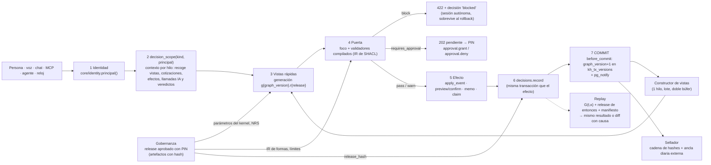

# Infraestructura operativa de Khipus: decisiones, puertas, vistas rápidas y gobernanza

*Diseño final del 2026-10-12. Implementa el mandato de Fabrizio («Objetos de Decisión, Puertas SHACL, Hot Path Views, Gobernanza: prioriza auditabilidad, velocidad y trazabilidad total») y sigue el plan de `docs/BRECHAS_V2.md` (bloques 0-5).*

**Cómo se hizo.**
- Se compararon dos diseños independientes y se eligió uno como base. El elegido es el A, "núcleo mínimo"; el B, "auditoría primero", le aportó varias piezas (Anexo A).
- Todas las cifras están medidas en los mapas de evidencia (MAP 1, 2, 3, D, G y V), en los bancos de prueba de los dos diseños o en una medición nueva de este documento (Anexo B).
- Respeta `docs/ARQUITECTURA_V2.md`: Postgres como única base, un solo kernel, el libro mayor fuera del grafo, la IA nunca decide números y el humano aprueba el dinero (§2.2, §3.4, §7, §8, §12-17, §19 y §20).

---

## 0. En simple (para Fabrizio)

1. **Cada acción deja una "ficha de decisión" que nadie puede borrar ni cambiar.** Vale para tus acciones, las de un agente, las de una IA conectada por MCP y las del reloj automático. La ficha dice quién fue, qué datos vio, qué reglas se aplicaron, quién lo aprobó y qué pasó después.
2. **Puedes abrir cualquier decisión pasada y apretar "¿Por qué?" o "Repetir".** Khipus la vuelve a calcular con lo que *sabía en ese momento* y con las reglas *de ese momento*, y te dice si da lo mismo o qué cambió.
3. **Las reglas están escritas en un solo lugar.** Por ejemplo: "una relación no puede apuntar a sí misma" o "una compra no puede dejar un sector por encima del 40 %". Lo que no cumple se rechaza al instante con un mensaje claro en español e inglés. Si una regla pide a un humano, la acción queda esperando tu PIN.
4. **Todas las pantallas dan el mismo número, al instante.** "Si cae TSMC" da una sola cifra en el X-Ray, la Cabina, la voz, el chat y el MCP. Hoy hay siete respuestas distintas, de 164 a 319 empresas. Las respuestas salen de "vistas rápidas" ya calculadas: menos de 1 ms en vez de 68-964 ms.
5. **Los números del sistema no cambian sin tu aprobación.** Hablamos de pesos del motor, límites de riesgo y umbrales del comité. Antes de aprobar con tu PIN ves "qué cambia" en lenguaje simple.

**Qué cambia para ti:**
- El PIN te identifica **a ti**. Ya no vale un nombre escrito a mano.
- En 🩺 aparece una pestaña nueva, **⚖ Auditoría**, con dos secciones: Decisiones y Gobernanza.
- Algunas cosas que hoy pasan solas quedan esperando tu aprobación: cambios al grafo que proponen los agentes y órdenes que propone una IA.
- Vas a recibir una lista corta de decisiones (sección 10 y tabla D1-D7).

**Qué hacer ahora:**
1. Activar "Wait for CI" en Railway y confirmar que `TRADE_PIN` y `SECRET_KEY` existen (BRECHAS #2).
2. Responder #4 y #5 de BRECHAS (socios y escala de severidad).
3. Leer la tabla D1-D7 de la sección 10. Los pasos 1 a 10 del plan no necesitan nada más de ti.

---

## 1. Principios y cómo encajan los cuatro pilares

### 1.1 Principios (cada uno es verificable con una prueba)

| # | Principio | Consecuencia concreta |
|---|---|---|
| P1 | **Postgres es la única verdad** (ARQ §11, §19.7) | Libro mayor, gobernanza y vistas se derivan de tablas Postgres. No hay base de grafos, ni vectorial, ni RDF, ni cola externa. |
| P2 | **Todo registro de verdad solo crece** | `events`, `decisions*`, `gov_*`, `ai_calls`, `kh_tx_versions` y `broker_audit` tienen disparador append-only. Una corrección es un registro nuevo (`supersedes_id`, `retracts_event_id`), nunca un UPDATE. |
| P3 | **Una sola puerta por clase de cosa** | `apply_event` (grafo), `brokerage.service.preview_order → confirm_order/approve_preview` (dinero), `core/decisions` (decisiones), `core/governance` (reglas y parámetros), `core/ai.py` (IA). |
| P4 | **Una vista es una función pura y versionada de la verdad** | Vista = Φ(L, graph_version, release). Leer nunca reconstruye. Toda respuesta lleva su versión. Hay un solo constructor y un solo kernel. |
| P5 | **SHACL es la fuente de las reglas, no el motor en vivo** | Los TTL se compilan a un IR. En producción corren validadores Python de 0,01-0,3 ms. pySHACL es el oráculo en CI y en la auditoría nocturna. |
| P6 | **Las reglas y los números son datos aprobados** | Cada parámetro, umbral, forma y prompt es un artefacto con hash. Manda el *release* aprobado con PIN que está en la base. El repositorio solo propone. |
| P7 | **Nada se pierde por fallar** | Un rechazo se registra igual, en una sesión autónoma. El dinero falla cerrado. Las lecturas degradan marcadas `stale`. |
| P8 | **La IA argumenta, la matemática decide los números, el humano aprueba el dinero** (ARQ §14) | Las puertas, el kernel, el sizing y los controles son deterministas. La IA solo narra, con el guardián de cifras. Lo que propone una IA siempre queda `requires_approval`. |
| P9 | **1 worker y 12 hilos** | Todo el estado vive en un solo proceso, así que el intercambio atómico de vistas es una asignación de referencia. Ningún candado global se toma durante una transacción larga (medido: Anexo B). |

### 1.2 El recorrido de una acción



**Cómo se enganchan los pilares.** Todo se une por identificadores con hash:
- `graph_version` es κ del grafo.
- `release_hash` es κ de la configuración.
- `generation` es la versión de cada vista.
- `decision_id` es la ficha.

La decisión anota los tres primeros. El replay los usa para reconstruir exactamente lo que se sabía y lo que se aplicaba.

---

## 2. Pilar 1: Objetos de Decisión

Una decisión es una **fila del libro mayor, no un nodo del grafo** (ARQ §2.2 regla 5, §3.4 y §19.1). El nodo `Decision` que crea `RegistrarDecision` (`ontology/actions.py:436-451`) sigue existiendo, pero solo como **ancla**: guarda `properties.decision_id` y conserva su vínculo `about`.

### 2.1 Esquema (DDL)

**Dónde se crea cada cosa:**
- **Modelos:** `ontology/ledger_models.py`, sobre el mismo `Base`, así `create_all` los crea dentro de `init_schema`.
- **Columnas nuevas de tablas existentes:** en `ontology/db._COLUMNAS_TARDIAS`.
- **Disparadores:** en `core/ledger_ddl.py`, que generaliza el patrón probado de `brokerage/models.py:144-190` (DDL idempotente, cada paso en su `SAVEPOINT`). La tabla `_APPEND_ONLY_TABLES` lista las tablas protegidas.

```sql
-- Función genérica: hace que una tabla solo pueda crecer
CREATE OR REPLACE FUNCTION kh_append_only() RETURNS trigger LANGUAGE plpgsql AS $$
BEGIN RAISE EXCEPTION '% es append-only: % no permitido (append-only)', TG_TABLE_NAME, TG_OP; END $$;
-- Por tabla de _APPEND_ONLY_TABLES:
--   CREATE TRIGGER <t>_no_modify  BEFORE UPDATE OR DELETE ON <t> FOR EACH ROW       EXECUTE PROCEDURE kh_append_only();
--   CREATE TRIGGER <t>_no_truncate BEFORE TRUNCATE        ON <t> FOR EACH STATEMENT EXECUTE PROCEDURE kh_append_only();
-- _APPEND_ONLY_TABLES = events, kh_tx_versions, decisions, decision_refs, decision_outcomes,
--   decision_violations, ledger_seals, ledger_anchors, ledger_meta, gov_artifacts, gov_releases,
--   ai_calls, hot_view_builds (+ broker_audit, que ya lo tiene)

CREATE TABLE decision_blobs (                -- contenido direccionado por hash: termina el corte a 12.000 caracteres de committee_memos.inputs
  sha256            char(64) PRIMARY KEY,    -- sha de los bytes canónicos SIN comprimir
  kind              text NOT NULL,           -- inputs|output|account_snapshot|plan|payload|focus|gate_report|ai_input|ai_output|replay_report
  body              bytea,                   -- json canónico comprimido con zlib; NULL solo tras purga por retención
  size_bytes        integer NOT NULL,
  retention_class   text NOT NULL CHECK (retention_class IN ('legal','standard_90d')),
  created_at        timestamptz NOT NULL DEFAULT clock_timestamp(),
  purged_at         timestamptz,
  purge_decision_id uuid
);
-- Disparador kh_blob_guard: DELETE y TRUNCATE siempre prohibidos. UPDATE permitido SOLO si
--   current_setting('khipus.retention_job', true) = 'on' AND OLD.retention_class = 'standard_90d'
--   AND OLD.created_at < now() - interval '90 days' AND NEW.body IS NULL AND NEW.sha256 = OLD.sha256
--   AND NOT EXISTS (SELECT 1 FROM decision_refs r JOIN decisions d ON d.id = r.decision_id
--                   WHERE r.ref_kind = 'blob' AND r.ref_id = OLD.sha256 AND d.durability = 'sync')
--   AND NOT EXISTS (SELECT 1 FROM decisions d WHERE d.durability = 'sync' AND OLD.sha256 IN (d.inputs_sha, d.output_sha))

CREATE TABLE decisions (
  id              uuid PRIMARY KEY,                 -- se reserva al ENTRAR en decision_scope (antes de los efectos)
  seq             bigint GENERATED ALWAYS AS IDENTITY UNIQUE,
  kind            varchar(48) NOT NULL CHECK (kind ~ '^[a-z_]+(\.[a-z_]+)+$'),   -- vocabulario cerrado: artefacto ledger.kinds
  kind_version    smallint NOT NULL DEFAULT 1,
  durability      varchar(5) NOT NULL CHECK (durability IN ('sync','async')),
  status          varchar(16) NOT NULL CHECK (status IN ('proposed','pending_approval','approved','rejected','blocked',
                    'executed','failed','noop','answered','fired','recorded','expired')),
  parent_id       uuid REFERENCES decisions(id),    -- propuesta→aprobación→ejecución; memo→aprobación→preview→confirm→submit
  supersedes_id   uuid REFERENCES decisions(id),    -- corrección: NUNCA un UPDATE ("superseded" se DERIVA, no es un estado)
  correlation_id  varchar(64),                      -- req_id del chat, sesión MCP, job_id, run_id de reconcile
  principal_id    varchar(96) NOT NULL,             -- op:fabrizio · agent:cadena@1.0 · mcp:<token_id> · system:<tarea> · anon:<owner_hash16>
  principal_kind  varchar(12) NOT NULL CHECK (principal_kind IN ('human','agent','system','external_ai')),
  auth            varchar(16) NOT NULL CHECK (auth IN ('pin','mcp_token','oauth','agent_registry','scheduler','none')),
  channel         varchar(12) NOT NULL,             -- ui|voice|chat|terminal|crypto|mcp|agent|scheduler|cli|api
  declared_name   varchar(80),                      -- lo que escribió el cliente en "actor": SOLO informativo
  on_behalf_of    varchar(96),                      -- client_id u owner_hash
  subject         jsonb NOT NULL DEFAULT '{}',      -- {entity_ids[], client_id, symbol, object_id, memo_id, claim_ids[], factor_id}
  valid_at        timestamptz NOT NULL,             -- t: el "cuándo" de la pregunta
  recorded_at     timestamptz NOT NULL DEFAULT clock_timestamp(),
  expires_at      timestamptz,
  txid            xid8 NOT NULL DEFAULT pg_current_xact_id(),
  lineage_id      uuid NOT NULL,                    -- ledger_meta: detecta restauraciones de la base
  graph_version   bigint,                           -- κ del grafo que se leyó (versión de la generación de vistas)
  known_snapshot  pg_snapshot,                      -- κ exacto para lecturas de OTRAS tablas (claims, memos); opcional
  release_hash    char(64) NOT NULL,                -- κ de configuración (gobernanza)
  code_sha        varchar(40) NOT NULL,             -- RAILWAY_GIT_COMMIT_SHA o 'unknown' (el 🩺 avisa)
  manifest        jsonb NOT NULL,                   -- manifest/1 (§2.4), ≤ 16 KB; lo grande va a blobs
  manifest_sha    char(64) NOT NULL,
  inputs_sha      char(64) REFERENCES decision_blobs(sha256),
  output          jsonb,                            -- resultado compacto (≤ 8 KB)
  output_sha      char(64),
  verdict         jsonb NOT NULL DEFAULT '{}',      -- resumen de GateReport/1: {outcome, shapes, n_block, n_warn, n_approval}
  model           jsonb                             -- {provider, model, prompt_sha, agent_version, ai_call_ids[]}
);
CREATE INDEX ix_dec_kind_time ON decisions (kind, recorded_at DESC);
CREATE INDEX ix_dec_principal ON decisions (principal_id, recorded_at DESC);
CREATE INDEX ix_dec_corr      ON decisions (correlation_id) WHERE correlation_id IS NOT NULL;
CREATE INDEX ix_dec_parent    ON decisions (parent_id)      WHERE parent_id IS NOT NULL;
CREATE INDEX ix_dec_pending   ON decisions (recorded_at)    WHERE status = 'pending_approval';
CREATE INDEX ix_dec_subject   ON decisions USING gin (subject jsonb_path_ops);
CREATE INDEX ix_dec_txid      ON decisions (txid);

CREATE TABLE decision_refs (            -- evidencia, efectos, vistas, política, causa; se pueden añadir DESPUÉS (solo INSERT)
  decision_id uuid NOT NULL REFERENCES decisions(id),
  role        varchar(10) NOT NULL CHECK (role IN ('evidence','effect','input','view','policy','cause')),
  ref_kind    varchar(20) NOT NULL,     -- event|claim|evidence|memo|broker_order|alpaca_order|broker_audit|proposal|alert|
                                        -- mcp_audit|ai_call|quote|view|artifact|source|job|run|reconcile_run|eod_price|blob|tool_result
  ref_id      varchar(128) NOT NULL,
  ref_hash    char(64),                 -- hash del contenido referido (cotización, fila del claim, artefacto, resultado de herramienta)
  as_of       timestamptz,
  note        jsonb,
  txid        xid8 NOT NULL DEFAULT pg_current_xact_id(),
  recorded_at timestamptz NOT NULL DEFAULT clock_timestamp(),
  PRIMARY KEY (decision_id, role, ref_kind, ref_id)   -- INSERT … ON CONFLICT DO NOTHING (no dispara UPDATE)
);
CREATE INDEX ix_dref_target ON decision_refs (ref_kind, ref_id);  -- "¿qué decisión produjo esta orden o usó este claim?"

CREATE TABLE decision_outcomes (        -- resultado POSTERIOR; nunca se pisa; el vigente es el último
  id           bigint GENERATED ALWAYS AS IDENTITY PRIMARY KEY,
  decision_id  uuid NOT NULL REFERENCES decisions(id),
  outcome_kind varchar(20) NOT NULL CHECK (outcome_kind IN ('order_status','fill','claim_eval','alert_ack','user_feedback',
                 'replay','expired','error','reverted','agree')),
  observed_at  timestamptz NOT NULL,    -- tiempo del mundo (hora del fill, del checkpoint)
  source       varchar(40) NOT NULL,    -- alpaca:activities · outcomes:outcome-v1 · falsifiers · user · replay:v1 · jev
  result       jsonb NOT NULL,          -- incluye dedup_key cuando aplica
  release_hash char(64) NOT NULL,
  txid         xid8 NOT NULL DEFAULT pg_current_xact_id(),
  recorded_at  timestamptz NOT NULL DEFAULT clock_timestamp()
);
CREATE INDEX ix_dout_dec ON decision_outcomes (decision_id, recorded_at DESC);
CREATE UNIQUE INDEX ux_dout_dedup ON decision_outcomes (decision_id, outcome_kind, (result->>'dedup_key'))
  WHERE result ? 'dedup_key';

CREATE TABLE decision_violations (      -- índice consultable de los GateReports ("¿qué regla bloquea más?", regresión de gobernanza)
  decision_id uuid NOT NULL REFERENCES decisions(id),
  ord         smallint NOT NULL,
  rule_iri    varchar(96) NOT NULL,
  severity    varchar(18) NOT NULL CHECK (severity IN ('block','requires_approval','warn','info')),
  focus       varchar(128) NOT NULL,
  value       jsonb,
  shapes_hash char(64) NOT NULL,
  PRIMARY KEY (decision_id, ord)
);
CREATE INDEX ix_viol_rule ON decision_violations (rule_iri);

CREATE TABLE ledger_seals (             -- UNA cadena para todo lo que es verdad o evidencia
  seal_no    bigint GENERATED ALWAYS AS IDENTITY PRIMARY KEY,
  row_table  varchar(24) NOT NULL,      -- events|kh_tx_versions|decisions|decision_refs|decision_outcomes|gov_artifacts|gov_releases|ai_calls|broker_audit
  row_id     varchar(64) NOT NULL,
  row_sha    char(64) NOT NULL,         -- sha de la fila LEÍDA de la base (to_jsonb → forma canónica): sellar y verificar usan el mismo camino
  prev_hash  char(64) NOT NULL,
  hash       char(64) NOT NULL,         -- sha256(prev_hash ‖ row_table ‖ row_id ‖ row_sha)
  sealed_at  timestamptz NOT NULL DEFAULT clock_timestamp(),
  UNIQUE (row_table, row_id)
);
CREATE TABLE ledger_anchors (           -- cabeza diaria, exportada fuera de la base
  day date PRIMARY KEY, head_seal bigint NOT NULL, head_hash char(64) NOT NULL, n_rows integer NOT NULL,
  created_at timestamptz NOT NULL DEFAULT clock_timestamp(), exported jsonb
);
CREATE TABLE ledger_meta (              -- linaje: cluster_id + primer txid; detecta restauraciones
  lineage_id uuid PRIMARY KEY, cluster_id bigint NOT NULL, first_txid xid8 NOT NULL,
  created_at timestamptz NOT NULL DEFAULT clock_timestamp(), note text
);
```

**Columnas tardías.**
- `broker_audit.txid xid8` y `broker_audit.seq`, para poder sellarla.
- `events.txid`, `events.seq` y `events.release_hash`, que crea el paso 1 del plan.

**Guardia de proyecciones: "sin decisión no hay cambio".** La base lo impone, no la disciplina del código.

```sql
CREATE OR REPLACE FUNCTION kh_require_decision() RETURNS trigger LANGUAGE plpgsql AS $$
BEGIN
  IF coalesce(current_setting('khipus.decision_id', true), '') = '' THEN
    IF current_setting('khipus.guard_mode', true) = 'enforce' THEN
      RAISE EXCEPTION 'cambio sin decisión registrada / change without a recorded decision (%)', TG_TABLE_NAME;
    END IF;
    RAISE WARNING 'kh_guard: % sin decision_id', TG_TABLE_NAME;   -- modo warn: se cuenta en el 🩺
  END IF;
  RETURN COALESCE(NEW, OLD);
END $$;
-- BEFORE UPDATE OR DELETE en: research_claims, committee_memos, broker_orders, proposed_actions,
--   alerts, broker_clients, ai_settings;  + BEFORE INSERT en broker_orders.
```

- **Cómo se activa:** `decision_scope` ejecuta `SELECT set_config('khipus.decision_id', :id, true)` al entrar. El valor es local a la transacción, así que con el pool de SQLAlchemy no se filtra a otra petición.
- **Costo medido** (`guard_bench.py` del diseño B): 0,56 ms contra 0,60 ms por UPDATE + commit, es decir, dentro del ruido.
- **Despliegue en dos fases:** primero `warn` (paso 22 del plan) y después `enforce`, cuando todos los sitios de §2.5 ya emiten su decisión.

### 2.2 El servicio único: `core/decisions.py`

```python
@dataclass(frozen=True)
class Principal:                      # core/identity.py
    id: str; kind: str; auth: str; channel: str
    declared_name: str | None = None; on_behalf_of: str | None = None

def principal_from_request(req, *, require=('pin',)) -> Principal   # core/identity.py

@contextmanager
def decision_scope(kind: str, principal: Principal, *, subject=None, durability=None, parent_id=None,
                   correlation_id=None, valid_at=None, session=None) -> DecisionCtx:
    """Reserva decision_id, hace set_config('khipus.decision_id'), abre un contextvar.
    Al salir: record() con el estado según veredicto/excepción; si hubo 'block' → record_rejection()."""

class DecisionCtx:                    # se llena SOLO desde los puntos instrumentados, o a mano
    def read_view(self, name, generation, content_sha=None, key=None)  # lo llama core/hotviews.get()
    def quote(self, q: dict)          # core/quotes.fetch_quotes_live: copia px/src/as_of/currency al manifiesto
    def blob(self, kind, obj, retention='legal') -> str                  # direccionado por contenido, devuelve sha
    def evidence(self, ref_kind, ref_id, *, ref_hash=None, as_of=None, **note)
    def effect(self, ref_kind, ref_id, **note)   # apply_event, preview/confirm, persistencia de claims y memos
    def ai_call(self, ai_call_id)                # core/ai.py (paso 21)
    def gate(self, report: 'GateReport')         # core/gates.check: se combinan por la severidad mayor
    def params(self, **overrides)                # ajustes por pedido (damping, rel_weights, max_hops: GV-10)
    def channel_proof(self, **proof)             # voz: readback_sha, confirmed_at

def record(session, ctx, *, status, output=None, expires_at=None) -> uuid
    # sync: en la MISMA sesión que el efecto. Si no se puede escribir, el efecto se revierte (no hay orden sin su decisión).
    # async: cola en el proceso (lote cada 1 s, tope 5.000); si la cola se llena → escritura síncrona;
    #        lo que se pierde en una caída del proceso (≤ 1 s) se cuenta en ledger.dropped (🩺).
def record_rejection(ctx, report) -> uuid        # sesión AUTÓNOMA (otra conexión): sobrevive al rollback del efecto
def approve(session, target_id, principal, *, verdict='grant'|'deny', effective_from=None, note=None) -> uuid
    # crea approval.grant|approval.deny con parent_id=target; exige principal humano con auth='pin';
    # si el origen fue agente, MCP o comité, el aprobador siempre es distinto del solicitante
def link(session, decision_id, role, ref_kind, ref_id, **kw)          # añadir referencias más tarde (solo INSERT)
def outcome(session, decision_id, outcome_kind, result, *, observed_at, source) -> int
def supersede(session, old_id, ctx, reason) -> uuid                    # decisión nueva con supersedes_id
def get(decision_id, *, redact=True) / lineage(decision_id) / explain(decision_id, lang)
def stamp() -> WorldStamp   # graph_version y generación (en memoria, sin SQL), release_hash, code_sha, lineage_id
```

**Detalles de implementación:**
- **El contexto viaja a los hilos.** `core.ai_usage.bind(fn)` ya propaga `ai_context` a los pools de hilos; se extiende para copiar también el contextvar de la decisión (`contextvars.copy_context()`).
- **Durabilidad por defecto según el prefijo del kind:**
  - `sync` para `order.*`, `approval.*`, `ontology.*`, `proposal.*`, `committee.*`, `research.*`, `claim.*`, `alert.rule`, `reconcile.*`, `policy.*`, `governance.*`, `trade.*`, `audit.*` y `retention.*`;
  - `async` para el resto.
- **Estado vigente de una cadena de decisiones:** lo da la vista SQL `decision_heads` (el último hijo por raíz y el último `supersedes`). Nunca se hace un UPDATE.

### 2.3 Tipos de decisión: vocabulario cerrado

El vocabulario vive en el artefacto `ledger.kinds` (con espejo en `core/decisions.KINDS`) y lo valida la forma `khs:DecisionShape`.

**Ontología**
- `ontology.action`, `ontology.raw_event`, `ontology.bulk_import`, `ontology.news_ingest`
- `proposal.create`, `proposal.auto_apply`

**Aprobaciones** (unificadas para todos los dominios: "¿quién aprobó qué?" es una sola consulta)
- `approval.grant`, `approval.deny`

**Dinero**
- `order.preview`, `order.confirm`, `order.submit`, `order.cancel`, `order.expire`
- `trade.agent_signal`
- `committee.run`, `committee.portfolio_advice`

**Investigación**
- `research.job`, `research.run`, `claim.status`

**Operación**
- `alert.rule`, `alert.fire`
- `whatif.shock`, `whatif.factor_fire`, `simulation.save`, `insight.snapshot`
- `chat.route`, `chat.answer`, `mcp.tool_call`
- `reconcile.plan`, `reconcile.apply`, `reconcile.rollback`

**Gobernanza y control**
- `policy.change`, `governance.propose`, `governance.validate`, `governance.activate`
- `retention.purge`, `ledger.lineage_break`, `ledger.chain_ack`, `audit.replay`, `audit.gates`

### 2.4 Manifiesto de entradas (`manifest/1`): lo que el sistema "sabía"

```json
{"schema":"manifest/1","valid_at":"2026-10-12T14:03:11Z",
 "knowledge":{"graph_version":18234,"generation":"g18234.r9f3a0c1d.pg","known_snapshot":"230913:230915:230913",
              "lineage_id":"…","source":"pg"},
 "release":{"hash":"9f3a…","semver":{"kernel.params":"1.0.0","policy.broker_risk":"1.0.0","ontology.shapes":"1.0.0"}},
 "code_sha":"<RAILWAY_GIT_COMMIT_SHA>",
 "impl":{"kernel":"propagate@1","nrs":"client_nrs@1","gates":"gate_eval@1","risk":"run_checks@1","sizing":"compute_sizing@1"},
 "views":[{"name":"account","version":"house@2026-10-12T14:03:05Z","content_sha":"…","age_ms":420},
          {"name":"card","version":"g18234.r9f3a0c1d.pg","key":"NVDA","content_sha":"…"}],
 "quotes":[{"ticker":"NVDA","px":181.20,"prev":179.90,"currency":"USD","src":"finnhub","as_of":"2026-10-12T14:03:02Z"}],
 "account":{"blob":"<sha256>","fetched_at":"…","src":"alpaca","mode":"paper"},
 "evidence_summary":{"claims":3,"events":1,"sources":2},
 "request_params":{"damping":null,"rel_weights":null,"max_hops":null},
 "focus_blob":"<sha256>",
 "channel_proof":{"kind":"voice_readback","readback_sha":"…","confirmed_at":"…","window_s":180},
 "privacy":{"message_hmac":"…","key_id":"k1","len":84,"lang":"es"}}
```

- **Campos obligatorios:** dependen del kind y los fija `governance/shapes/decision.ttl`. Se validan dentro de `record()` (la puerta G8).
- **El foco de la puerta** (los literales exactos que entraron a la regla) se guarda como blob. Eso es "exactamente lo que se vio". El replay prueba además que esos literales salían de la vista en esa versión.

### 2.5 Migración de los sitios de llamada

Las referencias `archivo:línea` vienen de MAP D §4, MAP 2 y MAP G. "Sinc." = durabilidad.

| Kind | Sinc. | Sitio actual | Manifiesto mínimo y evidencia | Efectos (refs `effect`) | Resultado posterior |
|---|---|---|---|---|---|
| `ontology.action` | sync | `ontology/api.py:235` → `actions.py:705/714 execute_action`. `_log_action` (`:198`) lleva `decision_id` en el payload de `ActionExecuted` | knowledge, release, shapes, payload (blob), objetos y fuentes citadas | cada `event` escrito por `apply_event` (lo recoge el contexto) | `reverted` si una retracción lo deshace |
| `ontology.raw_event` | sync | `ontology/api.py:981` | ídem; pasa por la misma puerta G1 | event | — |
| `ontology.bulk_import` | sync | `api.py:359`, `bulk_import.py:166` | sha del lote + cuarentena (blob) | events | — |
| `ontology.news_ingest` | async | `api.py:888`, `ingest_news.py:95` (un lote por empresa) | hash de la URL, fuente | events | — |
| `proposal.create` | sync | `agents.py:759/781` (hoy se guarda **sin validar**) | agente@versión, confianza, explicación, GateReport en modo aviso (G-PROP) | proposal_id | — |
| `proposal.auto_apply` | sync | `agents.py:710/737` (`principal=system:auto_apply`; hash de `policy.auto_apply`) | regla aplicada, confianza | events | — |
| `approval.grant` / `.deny` | sync | `ontology/api.py:574/604`; `committee.py:1752/1857`; `brokerage/service.py:1175/1194`; gobernanza | target (padre), PIN, `effective_from` | — | — |
| `order.preview` | sync | `brokerage/service.py:849-898`. Después del bloque 3 también la casa `server.py:2599`, el cierre `:2552`, el agente `:5466/5478`, la voz `voice.js:2918` y el MCP `tools.py:1552` | foto de la cuenta (blob), cotización {px, src, as_of}, vistas account y card, `policy.broker_risk`, GateReport | broker_order | `order_status` |
| `order.confirm` | sync | `service.py:1121` (vuelve a correr las puertas, como hoy `:1010-1040`) | foto nueva + `channel_proof`; si cambió el release entre preview y confirm, se estampan los dos hashes | — | — |
| `order.submit` | sync | envoltorio de `brokerage/alpaca.py:179`: la intención se escribe **antes** del envío | `client_order_id` | alpaca_order, broker_audit | `order_status`, `fill` (actividades de Alpaca → `broker_fills`) |
| `order.cancel` / `.expire` | sync | `service.py:1292`, `:1104`; `tools.py:1638` | — | — | — |
| `trade.agent_signal` | sync | `server.py:5324/5526` (hoy solo existe en el log en memoria `_AGENT['log']` `:5239`) | ai_call, confianza, motivo, precio, tono GDELT | hijo: `order.preview` | el de la orden |
| `committee.run` | sync | `research/committee.py:964-1212`, al guardar el memo | claims (ref_map con `ref_hash`), track record, vol, mandato, vistas, cotización, `policy.committee`, prompts, ai_calls; transcripción como blob | memo | `claim_eval` (vía claims) |
| `committee.portfolio_advice` | sync | `research/committee_api.py:250` (hoy no se guarda) | posiciones (con el owner_hash), convicciones, vistas | — | — |
| `research.job` / `research.run` | sync | `runner.py:349`, `router.py:99` (automático); `runner.py:575-602` | disparador; evidencia E#, prompt_sha, modelo | job_id; ids de claims | partial/deferred/done; `claim_eval` desde `outcomes.py:504` |
| `claim.status` | sync | `runner.py:600/443`, `falsifiers.py:177` (hoy UPDATE masivo silencioso) | regla del falsador, métrica, valor | claim (estado nuevo) | — |
| `alert.rule` | sync | `ontology/api.py:659/682` (hoy sin PIN; queda con el dueño + decisión) | regla | alert | — |
| `alert.fire` | async | `agents.py:909/924` (hoy sobrescribe `last_fired_at`) | valor, umbral, versión de la vista card o quote | — | `alert_ack` |
| `whatif.shock` / `whatif.factor_fire` | async | `matrix/api.py:283`, `:844`; `/api/hot/scenario` **cuando el usuario actúa** (no al pasar el ratón) | choques, factores, `request_params`; salida = top-50 + content_sha | — | — |
| `simulation.save` / `insight.snapshot` | sync / async | `matrix/api.py:355`, `:707` (deduplicado por `(graph_version, release_hash, as_of, lang)`, GV-02) | vistas | evento Simulation, insight | — |
| `chat.route` | async | `core/decide.py:323/341` (Jev); reemplaza la clave cruda de `decision_shadow` (`research/models.py:312`) | HMAC del mensaje, probabilidades, hash de `policy.decide`, modelo Jev | — | `agree` |
| `chat.answer` | async | `core/khipu_chat.py:2254 run_chat` | hechos [F#], `sources[].as_of`, `agents_used`, vistas, ai_calls; **sin el texto del usuario** | ai_call | `user_feedback` |
| `mcp.tool_call` | async (lectura) / sync (trade, research) | `mcp_server/api.py:406`; `tools.py:1272/1370/1552/1587/1638` | principal `mcp:<token_id>`, args redactados, **digest del resultado** (cierra MAP 2 #15) | mcp_audit, order | — |
| `reconcile.plan` / `.apply` / `.rollback` | sync | `reconcile.py:543/660` | blob del plan; `expect` = **sha del plan** (GV-13, G-7) | reconcile_run, events | — |
| `policy.change` | sync | `brokerage/service.py:360/432` (límites del cliente con valor anterior y nuevo); `core/ai_usage.py:263`; `server.py:5676/5711/5749` (configuración del agente) | diff antes/después | — | — |
| `governance.*` | sync | nuevo (`core/governance.py`) | artefacto, reporte de regresión | gov_release | — |

**Órdenes por voz.** `engine/voice.js:2918 _executeTradeOrder` envía:
- `X-Khipu-Channel: voice`;
- `readback_sha`, el sha del resumen que se leyó en voz alta;
- `confirmed_at`.

El servidor lo guarda en `channel_proof` y la regla `khr:order.voice_readback` lo exige.

### 2.6 Cómo se referencia la evidencia

| Evidencia | `ref_kind` / `ref_id` | Huella |
|---|---|---|
| Claim | `claim` / `research_claims.id` | sha de (texto, confianza, método conf-v2, estado visible en κ) |
| Evidencia E# | `evidence` / id | sha de la URL y la fecha |
| Evento del grafo | `event` / `events.id` | sellado en `ledger_seals` |
| Vista | rol `view` / `card@g18234.r9f3a0c1d.pg[:key]` | `content_sha` de la generación (`hot_view_builds`) |
| Cotización | `quote` / `NVDA@<as_of>` + fila en `manifest.quotes` | sha de (px, src, as_of, moneda). **No depende** de `eod_prices`. |
| Precio EOD (tras el bloque 2) | `eod_price` / `instrument:date` | — |
| Fuente documental | `source` / `Source.id` | sha de la URL |
| Artefacto o política | rol `policy` / `policy.broker_risk@1.0.0` | hash del artefacto |
| Resultado de herramienta (chat, MCP) | `tool_result` / `get_company:<req>` | sha del JSON devuelto |
| Llamada a IA | `ai_call` / `ai_calls.id` | prompt_sha, output_sha |

### 2.7 Privacidad y retención

**Nunca se guarda texto personal crudo.**
- El mensaje del usuario se guarda como `HMAC-SHA256(k_pii, texto)` + largo + idioma + entidades detectadas.
  - La clave es `k_pii = HKDF(SECRET_KEY, 'khipus-ledger-pii')` y se registra su `key_id`.
  - Si en producción `SECRET_KEY` es la de por defecto (G5-18), se registra sin HMAC y con el aviso `privacy_key_weak`.
- `decision_shadow.key` pasa al mismo HMAC. Hoy guarda hasta 200 caracteres del mensaje.
- La IP y el dueño se guardan siempre como hash.
- Los textos que el operador escribe para justificar algo (`rationale`, `contexto`) **sí** se guardan, porque son auditables por diseño. Van a blobs `legal`.

**Retención** (artefacto `ledger.retention`, decisión D3):

| Qué | Cuánto |
|---|---|
| Todas las tablas append-only | Para siempre |
| Blobs de decisiones `sync` | `legal`, para siempre |
| Blobs de chat, qué-pasaría-si y salidas de IA no ligadas a una decisión `sync` | `standard_90d` |

**La purga** (`retention.purge`):
- deja `body = NULL` y conserva el `sha256`, así la integridad sigue demostrable;
- **nunca** purga un blob que una decisión `sync` cite; lo comprueba la función del disparador;
- no hace falta "promover" blobs ni ningún UPDATE de clase.

### 2.8 Sellado, verificación y ancla

**Por qué el sellado es asíncrono.** Encadenar dentro de la transacción serializa los 12 hilos:

| Diseño | 12 hilos, p50 | 12 hilos, p95 | Con 20 ms de trabajo en la transacción |
|---|---|---|---|
| Cadena dentro de la transacción | 14,4-15,6 ms | 19,6-22,0 ms | p50 **264 ms** |
| Inserción libre + sellado aparte | 2,55-2,6 ms | 4,5-5,7 ms | p50 21,2 ms |

Las dos filas se midieron por separado en A y en B.

**El sellador** (`core/ledger.py seal()`; tarea `ledger_seal` en `core/scheduler.py` cada 30 s, o se despierta tras un commit con más de 50 filas pendientes):
1. Toma `pg_try_advisory_xact_lock(<const>)`.
2. Lee la cabeza de la cadena.
3. Por cada tabla de la lista, toma las filas no selladas con `txid < pg_snapshot_xmin(pg_current_snapshot())` (solo transacciones terminadas), ordenadas por `(txid, seq)`.
4. Calcula `row_sha` desde `to_jsonb(fila)` en forma canónica (`json.dumps(sort_keys=True, separators=(',',':'), ensure_ascii=False)`). Sellar y verificar leen la base por el mismo camino.
5. Inserta los sellos en lote.

Costo medido: 480 filas en 10-12 ms (A); 1.590 filas en 34,5 ms (B).

**Verificación.** `verify(from_seal)` recalcula en ~10,5 ms cada 1.000 filas (B). Corre cada noche de forma incremental desde la última ancla.

**Ancla diaria.**
- Se escribe una fila en `ledger_anchors`.
- `GET /api/ledger/anchor` es público y solo devuelve `{day, head_seal, head_hash}`.
- El GitHub Action `smoke-mcp.yml` ya corre con `KHIPU_MCP_TOKEN`: la baja y la guarda como artefacto del run.
- Es la única defensa contra un superusuario que desactive los disparadores y reescriba todo de forma coherente.

**Cadena rota.** El 🩺 se pone en rojo y **el dinero real queda bloqueado** hasta que Fabrizio lo reconozca con PIN (decisión `ledger.chain_ack`). La lectura sigue.

**Linaje.** Si `pg_current_xact_id()` es menor que el máximo de `decisions.txid`, o si cambió `pg_control_system().system_identifier`, hubo una restauración:
- se escribe `ledger.lineage_break`;
- desde ahí, las lecturas de otras tablas en el replay usan `recorded_at` y se marcan `approximate`. Lo que depende del grafo **no** se degrada, porque `graph_version` es dato y sobrevive al restore.

### 2.9 Lectura y API

| Ruta | Acceso | Qué devuelve |
|---|---|---|
| `GET /api/ledger/decision/<id>` | PIN, o el dueño si `on_behalf_of` = su owner_hash | decisión, refs, violaciones, resultados, prueba de sello, explicación ES/EN |
| `GET /api/ledger/decisions?kind=&entity=&principal=&since=&status=` | PIN | listado filtrado |
| `GET /api/ledger/verify?from_seal=` | PIN | resultado de la verificación |
| `GET /api/ledger/anchor` | público, solo cabeza | `{day, head_seal, head_hash}` |

En el MCP, el alcance `read` ve un resumen redactado: sin blobs de cuenta ni posiciones.

**UI:** 🩺 → **⚖ Auditoría / Audit** → "Decisiones / Decisions" (`engine/audit.js`, bilingüe), con los botones "¿Por qué? / Why?" y "Repetir / Replay". Las claves nuevas de `engine/explain.js` son `decision_status`, `gate_verdict` y `view_freshness`.

---

## 3. Pilar 2: Puertas de validación (SHACL)

### 3.1 Catálogo de formas

Las formas viven en `governance/shapes/`, versionadas como el artefacto `ontology.shapes`.

**Prefijos**

| Prefijo | IRI | Para qué |
|---|---|---|
| `kh:` | `https://khipus.ai/ont#` | clases y propiedades |
| `khs:` | `https://khipus.ai/shapes#` | formas, más la severidad propia `khs:RequiresApproval` |
| `khr:` | `https://khipus.ai/rule#` | **una IRI estable por regla**: es la que aparece en el reporte y en `decision_violations` |
| `khp:` | `https://khipus.ai/policy#` | parámetros de política que se **inyectan como literales** del foco, desde el release activo. Ningún límite numérico se escribe en el TTL. |
| `khd:` | `https://khipus.ai/id/` | datos (`khd:obj/<id>`, `khd:order/<uuid>`) |

**Requisitos de cada forma** (los revisa `meta.ttl`):
- `sh:name`, `khs:rule <khr:…>`, `sh:message "…"@es` y `"…"@en`, y `sh:severity`.
- Prohibidos `VALUES`, `MINUS` y `SERVICE` en SPARQL; pySHACL los rechaza (MAP G).
- `vocab.generated.ttl` (las listas `sh:in` de tipos, relaciones y kinds) lo genera `scripts/build_shapes.py` desde `ontology/vocabulary.json` y `ledger.kinds`. **Nunca se edita a mano.**

**Reglas por archivo:**

| Archivo | Reglas (`khr:`) y severidad inicial | Cierra |
|---|---|---|
| `link.ttl` (foco: estado resultante del vínculo) | `link.rel_in_vocab` (block) · `link.no_self_loop` (block, con `sh:disjoint kh:source kh:target`, sin SPARQL) · `link.endpoints_live` (block) · `link.weight_range` [0, `khp:maxWeight`] (block; 6 hoy, 1 tras el bloque 5) · `link.confidence_range` [0,1] (block; **termina el recorte silencioso** de `service.py:114`) · `link.valid_interval` (validFrom ≤ validTo, block) · `link.flow_supplier_type` (un País o una Política no puede ser proveedor de flujo; SPARQL con impl, block) · `link.inverse_flow_live` (warn) · `link.high_conf_trusted_source` (conf ≥ 0,5 sin fuente de trust ≥ 2 → requires_approval) · `link.direction_text_suspect` ("usa"/"uses", warn; L3-12) · `link.dated_fact_has_source` (warn) | G-1, L3-12 |
| `object.ttl` | `object.type_in_vocab` (warn; pasa a block en una versión MAJOR, GV-08) · `object.type_immutable` (block) · `object.margin_range` [−1,1] (block) · `object.country_in_vocab` (warn) · `object.numeric_props` (`severity="alto"` → block) | GV-08, G-1 |
| `factor.ttl` (foco: estado RESULTANTE) | `factor.severity_scale` [0, `khp:severityScale`] sobre `severity` y `severity_crisis` (block; G-2: `ActivarFactor` sin severidad deja 8) · `factor.not_retired` (block) · `factor.coef_range` (0,1] y coeficiente faltante ≠ 0 (block; PROP-20) · `factor.fire_magnitude_le_1` con x0 = mag·coef (block; PROP-05) · `factor.has_live_members` (warn) · `factor.noop` (info) | G-2, PROP-05, PROP-20 |
| `action.ttl` | `action.principal_authenticated` (block) · `action.no_unknown_fields` (block; además `extra='forbid'` en Pydantic) · `action.auto_apply_allowed` (tipo ∈ `khp:safeAuto` y confianza ≥ `khp:autoMinConfidence`, block) · `action.agent_needs_human` (agente fuera de SAFE_AUTO, o vínculos sugeridos por IncorporarEmpresa con conf 0 → requires_approval) · `action.risk_level_range` (MarcarRiesgo ≤ 100) · `action.retraction_has_reason` (warn) | G-1, G-4 |
| `order.ttl` (foco: `kh:OrderIntent` + hechos de cuenta + exposición posterior) | Las ~17 comprobaciones de `brokerage/risk.py:185-431`, cada una con su IRI: `order.kill_switch`, `order.client_active`, `order.mode_live_enabled`, `order.symbol_tradable`, `order.restricted`, `order.max_order_usd`, `order.daily_cap`, `order.buying_power`, `order.position_pct_after`, `order.drawdown_stop`, `order.no_short`, `order.duplicate_window`, `order.unresolved`, `order.limit_deviation`, `order.market_hours` (warn). **Nuevas:** `order.sector_pct_after` (block; tope #1), `order.country_pct_after` (warn), `order.chain_exposure_after` (warn → block tras #1), `order.quote_fresh` (> `khp:maxQuoteAgeS` = 60 s → block), `order.account_fresh` (> 30 s → block), `order.ai_origin_needs_human` (origen mcp, comité o agente → requires_approval, salvo papel + `khp:autoApprovePaper`), `order.voice_readback` (canal voz sin prueba → block) | G-5, G5-01, L2-M3 |
| `committee.ttl` | `memo.not_expired` (TTL 72 h) · `memo.quorum` (INSUFFICIENT_DATA con BUY/SELL → block) · `memo.size_le_mandate` · `memo.unvalidated_half` (sin validar y tamaño > 0,5 × el crudo → block; L2-05) · `memo.manifest_complete` | L2-05 |
| `claim.ttl` | `claim.has_evidence` · `claim.horizon_in_set` · `claim.confidence_method` · `claim.money_conf_cap` (≤ 0,5 sin fuente externa) · `claim.falsifier_wellformed` (warn) | — |
| `governance.ttl` | `gov.semver_matches_diff` (un "patch" que cambia un número → block) · `gov.major_requires_report` (reporte de regresión + `effective_from` + PIN) | GV-06 |
| `decision.ttl` (meta-puerta del libro mayor) | `decision.kind_in_vocab` · `decision.principal_typed` · `decision.release_present` · `decision.manifest_required_fields` (por kind, con `sh:or`/`sh:qualifiedValueShape`) · `decision.quotes_have_asof_src` · `decision.money_executed_not_blocked` | GV-01 |

**Severidades.**

| Severidad SHACL | Efecto |
|---|---|
| `sh:Violation` | **block**: no se ejecuta |
| `khs:RequiresApproval` | **requires_approval**: queda en la cola humana. Es propuesta en la ontología, `pending_approval` en órdenes y PIN en gobernanza. SHACL admite cualquier IRI como severidad; una prueba comprueba que pySHACL la devuelve tal cual. |
| `sh:Warning` | **warn**: pasa y queda anotado |
| `sh:Info` | **info**: solo se anota |

`policy.gates` puede cambiar la severidad de cada regla. **Una regla nueva entra como warn (MINOR)** y pasa una semana en sombra. Luego sube a block con una versión MAJOR aprobada con PIN, viendo el reporte de sombra.

### 3.2 Grafo foco y mapeo a RDF

Hay **una sola función por foco** en `core/gates/focus.py`: `focus_link`, `focus_object`, `focus_factor`, `focus_action`, `focus_order`, `focus_memo`, `focus_claim`, `focus_decision`.
- Cada una devuelve una lista de tripletas Python `(s, p, o)`.
- En vivo las consume el evaluador compilado, sin rdflib.
- En pruebas y en la auditoría, `to_rdflib(triples)` (importado de forma perezosa) arma el grafo para pySHACL.

Como **el mismo mapeo alimenta a los dos**, la prueba de conformidad cubre también el mapeo.

**Reglas de literales** (las trampas medidas en MAP G):
- enumerados (rel, tipo, canal, modo) como literales **simples**, nunca `^^xsd:string`;
- números como `xsd:decimal` a partir de `Decimal(str(x))`;
- fechas como `xsd:dateTime` en UTC;
- IRIs de entidad codificadas con porcentaje.

**De dónde sale cada dato del foco** (injerto del diseño B):
- **Reglas que bloquean** leen solo el estado de la **transacción**: las filas que escribe y las que lee en ella, con `SELECT … FOR SHARE` sobre los extremos. Así una vista vieja nunca deja pasar algo que rompa un invariante.
- **Reglas que avisan** (por ejemplo `inverse_flow_live`) pueden leer la vista GraphCore más el delta de la transacción.

**Reglas que cruzan entidades.** Las cifras agregadas las calcula **una vista** (el único motor), nunca SPARQL en vivo. Entran al foco como literales. Ejemplo de foco de orden:

```
khd:order/9b2 a kh:OrderIntent ; kh:symbol "NVDA" ; kh:side "buy" ; kh:notionalUsd 1500.00 ;
   kh:accountMode "live" ; kh:liveEnabled true ; kh:channel "voice" ; kh:origin "ui" ;
   kh:quoteAgeS 3 ; kh:accountAgeS 1 ;
   kh:sectorWeightAfter 0.43 ; kh:countryWeightAfter 0.31 ; kh:chainExposureAfter 0.22 .
khp:policy khp:maxSectorWeight 0.40 ; khp:maxChainExposure 0.30 ; khp:maxQuoteAgeS 60 .
```

- La exposición a la cadena es `Σᵢ wᵢ·Ψ[i,c]`, con Ψ = vista Impact. Las posiciones salen de AccountRisk, el sector y el país de Card, y la cotización de Quote.
- En pySHACL, la regla SPARQL equivalente recalcula el peso del sector con `SUM`/`GROUP BY` sobre las posiciones del foco. La conformidad garantiza que el literal precalculado coincide.

**Tamaño del foco** (MAP G): p50 240 tripletas, p95 1.240, máximo 2.270 (Nvidia).

### 3.3 Compilación y garantía de conformidad

```
governance/shapes/*.ttl ──(CI o a mano: scripts/build_shapes.py, con rdflib)──► governance/shapes/compiled.ir.json
  {source_sha, ir_hash, shapes:[{iri, target, severity, constraints:[{rule, kind: datatype|in|minInclusive|maxInclusive|
   minCount|maxCount|pattern|lessThanOrEquals|disjoint|class|sparql_impl, path, value|param, msg_es, msg_en, impl}]}]}
compiled.ir.json ──(arranque, solo stdlib, ~2 ms)──► closures de Python (core/gates/engine.py)
```

1. **`scripts/build_shapes.py`** hace lo siguiente:
   - regenera `vocab.generated.ttl`;
   - compila las restricciones de propiedad a un IR genérico;
   - convierte cada `sh:sparql` en `{"rule": IRI, "impl": "order.sector_cap@1"}`;
   - calcula `ir_hash = sha256(IR canónico)`, un hash **semántico**: un cambio de formato no lo mueve;
   - tiene un modo `--check` que se usa en una prueba, igual que la bóveda.
2. **`core/gates/rules.py`** registra cada impl con `@rule('order.sector_cap', v=1)`. El compilador falla si falta alguna, y el arranque también.
3. **Al arrancar** (`core/gates/engine.load_active()`):
   - carga el IR **del release activo**, que viene de la base (§5);
   - verifica su hash y que existan todas sus `impl`.
   
   Si algo no cuadra, el proceso **cierra las escrituras de dinero y de la ontología** (`503 gates_unavailable`, ES/EN), el 🩺 se pone en rojo y las lecturas siguen.
4. **Sin dependencias nuevas en producción.** `brokerage/risk.run_checks` se mantiene como envoltorio que devuelve un GateReport, y sus comprobaciones pasan a ser las `impl` de `order.ttl`. Así siguen valiendo las 48 pruebas de `test_brokerage.py`.
5. **Conformidad.** pyshacl 0.40.1 y rdflib 7.6.0 van en `requirements-dev.txt`, fijados en `constraints.txt`, y se instalan en `ci.yml`. Fuera de CI la prueba se salta sola; en CI una guardia exige que estén instalados. Pruebas:
   - (a) accesorios de un solo defecto por regla en `tests/fixtures/gates/*.json`: se espera exactamente esa IRI, severidad y valor;
   - (b) casos aleatorios con semilla = `ir_hash`: 300 por PR (unos 18 s) y 3.000 cada noche en un Action. Se exigen **0 diferencias** en conforms, conjunto de reglas, severidad y foco. MAP G ya midió 0 en 3.000.
   - (c) pySHACL ejecuta el **texto SPARQL real** del TTL, así que cada impl de Python queda verificada contra su texto.
6. **Auditoría fuera del camino en vivo:**
   - la tarea nocturna `gates_audit` corre los validadores compilados sobre **todo** el grafo vigente (1.000 vínculos en 17 ms, MAP G) y deja una decisión `audit.gates`;
   - un Action nocturno corre pySHACL sobre el snapshot exportado;
   - `scripts/audit_shacl.py` permite correrlo contra la base local de Fabrizio.

### 3.4 Dónde se ubican las puertas (todas síncronas, en el mismo proceso)

| Puerta | Lugar | Formas | Datos | Presupuesto p95 |
|---|---|---|---|---|
| **G1 ontología** | final de `ontology/service.apply_event` (`:92`), después de `_materialize` (`:325`) y antes del flush/commit. Cubre Acciones, eventos crudos, SAFE_AUTO, importación masiva y reconcile | link, object, factor | transacción (bloqueo) + GraphCore (aviso) | ≤ 1 ms |
| **G2 acción** | `ontology/actions.execute_action` (`:714`), antes del handler | action (+ Pydantic `extra='forbid'`) | payload, principal | ≤ 0,2 ms |
| **G-PROP** | `ontology/agents.py:781`, al crear la propuesta | link, action en modo **aviso** (el reporte queda adjunto para que Fabrizio lo vea antes de aprobar) | vista | ≤ 0,5 ms |
| **G-BULK** | `ontology/bulk_import.py:166` | link (lote compilado) | lote | ≤ 20 ms por 1.000 vínculos |
| **G3 orden** | `brokerage.service.preview_order` **y de nuevo** en `confirm_order` | order | AccountRisk (refrescada ≤ 30 s), Quote, Card, Impact | ≤ 0,5 ms (sin la red de Alpaca) |
| **G4 qué-pasaría-si** | `/api/matrix/factor/fire` (`:844`), `/api/hot/scenario` | factor (magnitud, escala) | GraphCore | ≤ 0,1 ms |
| **G5 comité** | `committee.py:1752`, antes de crear la preview | committee | memo + vistas | ≤ 0,3 ms |
| **G6 claims** | persistencia en `research/runner.py:575` | claim | — | ≤ 0,2 ms |
| **G7 gobernanza** | `core/governance.propose/approve` | governance | diff | — |
| **G8 decisión** | `core/decisions.record` | decision | manifiesto | ≤ 0,05 ms |

MCP, voz, chat y agente de trading **no tienen puertas propias**: todos entran por G1-G3 con su `origin`/`channel`. Eso es justamente el bloque 3.

### 3.5 Latencia

| Paso | p50 / p95 |
|---|---|
| Armar el foco (búsquedas en diccionario + 1-2 consultas en la transacción) | 0,1 / 0,6 ms (estimado: 240-2.270 entradas + ~0,2 ms por consulta) |
| Validadores compilados | 0,01 / 0,3 ms (medido MAP G, hasta 10k tripletas) |
| **Puerta completa** | **≤ 1 ms**, contra 52-307 ms de pySHACL |
| Importación masiva de 1.000 vínculos | 17 ms, contra 204 s de pySHACL |

### 3.6 El objeto de explicación: `GateReport/1`

Hay **una sola forma** de reporte en lugar de las cuatro de hoy (G-3).

```json
{"schema":"gate-report/1","gate":"order.pre_trade","outcome":"block","conforms":false,
 "shapes":{"artifact":"ontology.shapes","semver":"1.2.0","ir_hash":"9c1e…"},
 "focus":"khd:order/9b2…",
 "results":[{"rule":"khr:order.sector_pct_after","shape":"khs:OrderIntentShape","severity":"block",
   "path":"kh:sectorWeightAfter","value":0.43,"limit":0.40,
   "limit_from":"policy.broker_risk@1.1.0#max_sector_pct",
   "inputs":[{"view":"account","version":"house@2026-10-12T14:03:05Z"},{"view":"card","version":"g18234.r9f3a0c1d.pg","key":"NVDA"}],
   "message":{"es":"Tras esta compra, Semiconductores pesaría 43 % de tu patrimonio (tope 40 %).",
              "en":"After this buy, Semiconductors would be 43% of your equity (cap 40%)."},
   "explain_key":"sector_exposure"}],
 "latency_us":180}
```

- **Los mensajes** son plantillas del TTL con `{value}` y `{limit}` que llena el evaluador, con formato según el idioma. **Ninguna cifra viene de la IA.**
- **Dónde se guarda:**
  - resumido en `decisions.verdict`;
  - completo como blob `gate_report`;
  - fila por fila en `decision_violations`;
  - además en `BrokerOrder.checks`, para compatibilidad.
- **Respuestas HTTP:**

| Caso | Respuesta |
|---|---|
| Bloqueo | `422 {code:'gate_violation', error, error_en, report, decision_id}` (registrado con `record_rejection`) |
| Necesita a un humano | `202 {status:'pending_approval', decision_id, report}` |
| Pasa con avisos | `200 {…, warnings:[…]}` |

---

## 4. Pilar 3: Vistas de camino crítico (hot path views)

### 4.1 Contrato

1. **Función pura de la verdad.** Vista = Φ(L, graph_version, release). La construye **un solo** constructor sobre Postgres. Sin `DATABASE_URL` usa `data/grafo_v0.json` con el mismo código (`source:'pg'|'snapshot'`).
2. **Coherencia.** Las vistas derivadas del grafo se publican **juntas** como una `Generation` inmutable (`g{graph_version}.r{release[:8]}.{source}`). Nunca hay una tarjeta de una versión con un impacto de otra. Las vistas "vivas" (cotización, cuenta, geo) llevan su propia versión.
3. **Leer nunca reconstruye.** Cada petición toma **una** referencia: `g = hot.generation()`.
4. **Toda respuesta trae su versión** (contrato común de ARQ §15):

```json
{"data":{…},
 "view":{"name":"impact","generation":"g18234.r9f3a0c1d.pg","graph_version":18234,"release":"9f3a0c1d…",
         "built_at":"…","age_ms":812,"source":"pg","stale":false,"lag_versions":0},
 "as_of":"…","valid_at":"…","known_at":"…","method":"propagate@1","sources":[…]}
```

Además lleva `ETag: "impact:g18234.r9f3a0c1d.pg"` (el cliente revalida con 304) y la cabecera `X-Khipu-Graph-Version` en **todas** las respuestas `/api`, con la que el cliente invalida su caché.

### 4.2 Las vistas

| Vista | Clave | Campos | Tamaño | Construcción | Atiende a |
|---|---|---|---|---|---|
| **V1 GraphCore** | generation, `kernel.params` | id→idx, alias→canónico, etiqueta, tipo, sector, país; adyacencia tipada entrada/salida {w, conf, verified, relation_class}; CSR por relación; `dt` (Tᵀ precalculado); **factores activos y fragilidad** (`/api/hot/factors`); grado de flujo en pares distintos; ρ base | < 2 MB | 27 ms snapshot (A) / ≈60-110 ms PG (MAP 1/3) | todo lo de abajo; los 13 cargadores del servidor; research context/router sin escaneos lineales |
| **V2 Impact** | generation, kernel hash | CSC n×fuentes float32 (impacto % del colapso unitario **con los factores activos**), primer salto (int8); por fuente: alcance ≥ 1 % y ≥ 10 %, Σ impacto, PageRank; **ranking de cuellos de botella por Σ** (PROP-06) con el conteo como dato secundario; Ψ = esta matriz (M-code-01) | 6.175 nnz / 0,05 MB snapshot (A); 10.953 nnz / 0,09 MB PG (MAP 3) | **46-51 ms en lote** (A, MAP 3) contra 268-357 ms del bucle | X-Ray, Cabina, voz, sala de guerra, @cadena, estructura del MCP, escenarios, sim por agentes, exposición por cadena, Insights, Brief, Oportunidades, screener |
| **V2b DownCap** | generation, `caps_as_of` | Ψᵀ·c (capitalización aguas abajo en riesgo) | 8 KB | < 1 ms | ya no se reconstruye el tensor dentro de la petición (191-312 ms, MAP 3 W19) |
| **V3 Card + NRS** | generation, hash de `nrs.formula`, `fund_v` | tarjeta compacta: id, etiqueta, instrumentos, listado, sector, país, rol ES/EN, moat; **NRS y sus 5 términos** (vector completo); conteos de flujo en **pares distintos**; top-5 proveedores y clientes {id, w, class, conf, verified}; relacionadas; estructura (HHI, países, rango sistémico **desde V2**); valuación privada {valor, as_of, url} | 1,13 MB (MAP 2) | completa 5,2 s hoy (3,0 s de `tensor.structure`, que pasa a leer V2) → estimado < 1 s, **en segundo plano**; incremental por ids tocados y vecinos; vector NRS 10 ms | chat `local_fact`, voz `get_company_info`/`open_company`/`compare_companies`, MCP `get_company`, Centinela, alertas, World Monitor, carteras |
| **V4 Quote** | ticker | px, prev, pct, currency, src, as_of, live | 60 KB | ya existe: `core/quotes.fetch_quotes_live` (TTL 15 s); solo se **añade** el sello | chat, voz, alertas de precio (sin una llamada a Finnhub por alerta), precio de referencia de órdenes |
| **V5 AccountRisk** | (client_id\|house, account_ts, policy hash) | equity, cash, bp, nmbp, hwm; posiciones {sym, qty, mv, entity_id, sector, país}; USD usados hoy; órdenes recientes y sin resolver; foto del mandato y los límites; **pesos por sector y país; exposición Σwᵢ·Ψ[i,c] para los 10 cuellos principales** | 2-5 KB por cliente | lecturas a Alpaca (las de hoy, `_read_positions` `service.py:552`) + 0,1 ms | G3 (los 3 caminos de orden), comité, asesor de cartera, `get_exposure` |
| **V6 GeoRisk** | (world_version, id) | ≤ 3 hechos vivos por entidad | 200 KB | en cada refresco del mundo | @cadena, asesor, World Monitor (sin re-escanear 300 eventos por llamada) |
| **V7 AsOf** | LRU 16 × (t, known_gv) | G(t, κ) + matrices | ~0,3-1 MB cada una | 0,1-0,3 s al fallar; ≈1 ms al acertar | Grafo Temporal, `GRAPH ASOF`, replay |
| **V8 SeriesFeatures** | (instrument, eod_date) | r5/r20/r60, above_ma20, vol, beta, drawdown | 50 KB | diaria desde `eod_prices` (**llega con el bloque 2**) | comité, screener, @tecnico |
| AlertIndex (disparador, no vista) | (métrica, entidad) → alertas | — | — | — | evalúa las alertas cuando cambia V3 o V4, en vez de cada 120 s por navegador |

### 4.3 Versión del grafo: el contador se toma al confirmar

Este punto mejora a los dos diseños, medido en el Anexo B.

```sql
CREATE TABLE kh_versions   (name varchar(16) PRIMARY KEY, v bigint NOT NULL);           -- ('graph', 0)
CREATE TABLE kh_tx_versions (                                                            -- append-only, sellada
  txid xid8 NOT NULL, name varchar(16) NOT NULL, version bigint NOT NULL,
  release_hash char(64), committed_at timestamptz NOT NULL DEFAULT clock_timestamp(),
  PRIMARY KEY (name, version), UNIQUE (txid, name));
CREATE INDEX ix_events_structural ON events (recorded_at DESC)
  WHERE event_type IN ('ObjectCreated','ObjectUpdated','LinkCreated','LinkRemoved','LinkStatusChanged');
```

**Paso a paso:**
1. `apply_event` decide si el evento es **económico** con `_is_economic(ev)`. Lo es si:
   - es un vínculo con `rel_type` dentro del conjunto del kernel;
   - o es un objeto de tipo `economic` en el vocabulario, o un Factor;
   - o es `LinkStatusChanged`.
   
   En ese caso solo marca `session.info['kh_touched'] |= {ids}`, **sin tomar candados**.
2. Un hook `before_commit` de SQLAlchemy (`core/hotviews/signals.py`), si hay ids tocados, ejecuta:
   - `UPDATE kh_versions SET v=v+1 WHERE name='graph' RETURNING v`;
   - `INSERT INTO kh_tx_versions(txid, name, version, release_hash) VALUES (pg_current_xact_id(), 'graph', v, :rel)`;
   - `pg_notify('khipu_graph', {v, ids[:200]})`, que se entrega al confirmar.
   
   El candado de la fila dura **~1 ms**, no toda la transacción. Con 20 ms de trabajo: p50 21,7 ms con el candado al confirmar, contra 193 ms si se toma en el primer evento (Anexo B). Como la fila queda bloqueada hasta el commit, **el orden de `version` es el orden real de confirmación**. Eso arregla la carrera de MAP 3 §3.3 y M5 de MAP V.
3. Un hook `after_commit` llama a `hotviews.signal('graph', v, ids)`.

**Qué NO mueve la versión:** noticias, simulaciones guardadas, anotaciones, decisiones, tesis y ajustes de posición (W10-W12). Así se acaba la sobre-invalidación medida, que costaba 410-435 ms en `/metrics` con cada noticia.

**`ConfirmarVinculo` / `RechazarVinculo`** (`actions.py:308-334`) dejan de mutar `link.properties`. Pasan a emitir el evento nuevo **`LinkStatusChanged`** (W5, GV-02), que es económico.

**`_graph_epoch` se elimina** (`matrix/engine.py:684`). Hoy cuesta de 0,6 ms a 95 ms según la cantidad de eventos de auditoría. La versión ya vive en memoria.

**Eventos anteriores a la migración:** no tienen fila en `kh_tx_versions` y cuentan como versión 0, porque todos son de antes.

### 4.4 Constructor, señales e intercambio atómico

`core/hotviews/builder.py` es **un solo hilo demonio**.

**Señales de entrada:**
1. el hook `after_commit` (camino rápido);
2. un hilo `LISTEN khipu_graph, khipu_gov` para escritores fuera del proceso: CLI de reconcile, migración, el contenedor viejo durante un deploy, la PC local. Latencia medida: p50 0,09 ms;
3. cada 30 s, el reloj (`core/scheduler`) compara `kh_versions` (0,05 ms) por si se perdió un aviso.

**Cómo construye:**
- **Agrupa** las señales durante 1 s; nunca hay más de una construcción en curso.
- **Lee consistente:** una transacción `REPEATABLE READ READ ONLY` lee `kh_versions.v` **y** los datos en la misma foto. Medido: 0 inconsistencias en 2.175 fotos con 8 escritores concurrentes (Anexo B). La versión que anota la vista es exactamente la del contenido.
- **Orden de dependencias:** V1 → V2 → V2b → V3 (incremental).
- **Mismo kernel en lote.** `matrix.engine.propagate_many` hace la **misma** matemática que el bucle. Una prueba exige igualdad con `propagate` en los 937 choques; MAP 3 midió 10 diferencias de redondeo, que se corrigen redondeando igual.
- **Publica** con `_GEN = new_generation`. La asignación de referencia es atómica bajo el GIL: medido 1,7 µs y 0 errores en 532 millones de lecturas concurrentes (A).
- Escribe una fila en **`hot_view_builds`** (append-only, sin cuerpos): `(name, generation, graph_version, release_hash, source, content_sha, n, build_ms, built_at)`. Es la bitácora de "qué contenía cada vista". El replay la verifica reconstruyendo (§5.6).
- **Precalienta al arrancar** con `scheduler.register('hot_prewarm', …, run_at_start=True)`, incluida la importación de scipy.
- **Mientras calienta:** una lectura espera hasta 2 s. Si no, las rutas viejas calculan directo con el mismo kernel y marcan `source:'direct'`, y las rutas nuevas responden `503 view_warming` (ES/EN).
- **GIL:** durante la construcción en lote, otra lectura sube a p99 0,65 ms (MAP 3).
- **Memoria:** con doble búfer, menos de 50 MB.

### 4.5 Invalidación por señal

| Señal | Escrituras (MAP 3) | Invalida |
|---|---|---|
| `graph` (económico: LinkCreated/Removed/StatusChanged, Object* económico, factores) | W1-W6, W8, W9, W13, W14 | nueva generación: V1, V2, V2b, V3 (ids tocados + vecinos). V7 no se toca: su clave lleva `known_gv`, así que **el pasado con κ fijo no cambia por diseño** y las consultas nuevas usan la κ nueva |
| `graph.property` (CorregirDato: margen, país, crecimiento; económico) | W7 | V3(id), V6(id); V1 y V2 solo si cambia un dato del kernel |
| no económicas (News, Simulation, Decision, Annotation, Thesis, PositionAdjustment) | W10-W12 | **ninguna** |
| `release` (activación de gobernanza) / arranque | W17 | todas (el release forma parte de la clave) |
| `live.caps` (15 min) | W19 | V2b y los campos de capitalización de V3 |
| `live.fundamentals` (por ids) | W20 | V3 de esos ids (NRS) |
| `quotes` | W18 | V4 (TTL 15 s); **ya no** limpia el NRS en cada tick (`live.js:53`) |
| `user_state` PUT · orden, fill o aprobación | W23, W24 | V5 de ese dueño o cliente |
| claims y memos | W21, W22 | pizarra del comité (huella actual + NOTIFY `khipu_research`) |
| mundo | W25 | V6 |
| paso del tiempo | W26 | vencimiento de memos y claims por el reloj (`order.expire`, `memo.not_expired`) |

### 4.6 API `/api/hot/*` (nunca `/v1/*`)

| Ruta | Devuelve | Costo |
|---|---|---|
| `GET /api/hot/status` | todas las vistas: versión, edad, ms de construcción, último error | — |
| `GET /api/hot/impact/<id>?top=50` | víctimas [{id, pct, hop}], alcance ≥ 1 % y ≥ 10 %, Σ | 4 µs p50 / 34 µs p99 (A) |
| `GET /api/hot/impact/all` | CSC compacta con ETag | 78,7 KB / **22,6 KB gzip** con el snapshot (A); estimado ~40 KB con PG |
| `POST /api/hot/scenario` | `{shocks:[{id,magnitude}], factors:'active'\|'none'\|[ids], direction:'down'\|'up', params?, record?}` → impactos + cuadros por salto. `direction:'up'` usa el **mismo kernel** normalizado por fila con el mismo piso (PROP-17). Los parámetros solo de una lista permitida, y se anotan | ~1,6 ms con `dt` (MAP 1) |
| `GET /api/hot/chokepoints?by=sum\|count\|cap&limit=25` | ranking | < 0,1 ms |
| `GET /api/hot/factors` | factores activos, severidad, miembros, ρ | < 0,1 ms |
| `GET /api/hot/card/<id>?lang=` | tarjeta compacta | < 0,1 ms |
| `GET /api/hot/nrs?ids=` | vector NRS | ~0,01 ms (hoy 870 ms) |
| `GET /api/hot/exposure` (dueño con `X-Khipu-Owner`) · `POST` (cliente, con PIN) | sector, país, cadena | < 1 ms + lectura de cuenta |
| `GET /api/hot/asof?t=&known_at=` | grafo en una fecha (V7) | ≈1 ms en acierto |

**Rutas que delegan sin cambiar su forma:**
- `/api/matrix/{impact,factor/fire,metrics,insights,status,factors}`. `/impact` baja de 68 ms (p95 964 ms con 6 en paralelo) a < 0,1-1,6 ms.
- `/api/tensor/node`, que pasa a ser `card.structure`.
- `/api/world/exposure`, que toma el NRS de V3.

### 4.7 Un solo grafo y un solo motor: lo que se redirige o se borra

**Servidor: los 13 cargadores del snapshot pasan a ser accesores de V1** (`hot.graph()`). Son:
- `core/world.py:770`
- `core/entities.py:106/187`
- `core/screener.py:50`; además `:133` deja de leer el privado `matrix.api._TTL_CACHE`
- `core/sim_agents.py:85`
- `core/semantic.py:34`
- `core/portfolio_ai.py:230`
- `research/router.py:59`
- `research/context.py:204`
- `matrix/tensor.py:77` (Ψ = V2)
- `mcp_server/tools.py:258`

`ontology/reconcile.py:78` **conserva** su propia carga, porque compara el catálogo contra la base a propósito. Resultado: Postgres manda cuando existe, y una empresa creada con `IncorporarEmpresa` aparece en todo.

**Cliente: no queda ningún motor de contagio.** Archivo nuevo `engine/hotclient.js` (`window.KhipuHot`): `impact`, `scenario`, `card`, `nrs`, `chokepoints`, con caché por generación e invalidación por `X-Khipu-Graph-Version`. Va al SHELL de `sw.js` con el bump correspondiente.

| Hoy | Pasa a | Cierra |
|---|---|---|
| `engine/statematrix.js:91 simulate` (8 iteraciones, 0,6) | `KhipuState.simulate()` = colapso unitario → búsqueda en la ImpactView descargada; lo demás → `POST /api/hot/scenario`. statematrix.js queda **solo como animador** de los saltos (`hop`). Sin conexión: mensaje "no se puede calcular sin conexión / can't compute offline" en vez de un número distinto | PROP-01/02/12/19, G5-03/04 |
| `app.html:3712 computeDownstream` (+ `activateStress :3744/3748`, StressAI `:7127`, `secondbrain.js:201`) | ImpactView | PROP-03 |
| `engine/insights.js:146 clientInsights` (575 ms síncronos por tick) | `/api/hot/chokepoints` | PROP-03/06, MAP 1 #9 |
| `engine/brief.js:155 clientChokepoint` | `/api/hot/chokepoints` | PROP-03 |
| `engine/xray.js:534-615` (217→319 en la misma pantalla; 55 % fijo en `:601`) | una sola llamada (ImpactView / card.structure) | PROP-04, M-code-01 |
| `cockpit.js:2533/4252`, `livesim.js:155`, `voice.js:1567` | `/api/hot/scenario` **siempre con `factors:'active'`** | PROP-13 |
| `app.html:~8823` sala de guerra (4 iteraciones / 0,85) | `/api/hot/scenario` | PROP-11 |
| `core/scenario_engine.py:215` (BFS propio, 2 saltos, ×0,7/×0,45) | `detect()` + semillas + signo → el motor único (grado y aristas de flujo) | PROP-09/17, L4-03, L4-M2 |
| `core/sim_agents.py:587-640` (los % los escribe la IA) | % = −κ·impacto, con κ en `kernel.params`; la IA solo narra y se valida que cada % citado coincida | PROP-10, L4-04 |
| `engine/live.js:53` (`_invalidateNRS` en cada tick) | se quita: el NRS no depende del precio | MAP 1 C3 |
| `voice.js _flow` (78 clientes) contra MCP (95) | `/api/hot/card` (pares distintos) | MAP 2 B |
| `oswindows.js:312 apiTensor` | `/api/hot/card` | MAP 2 #3 |

Una prueba estática exige "no queda motor en el cliente": no existen `computeDownstream`, `clientInsights` ni `clientChokepoint`, y statematrix.js no tiene bucle de propagación.

**Reglas del repo en cada cambio de cliente:** bump de `sw.js` y textos en ES y EN.

---

## 5. Pilar 4: Gobernanza, versionado y repetición de decisiones

### 5.1 Registro de artefactos

Los archivos viven en `governance/artifacts/<id>@<semver>.json`. Cada uno es JSON canónico con `{id, semver, kind, params, deprecated?}`, y su identidad es `sha256(canónico)`. `scripts/build_governance.py --check` mantiene `governance/manifest.json` (lista y hashes) y corre en una prueba.

| Artefacto | Contenido | Origen hoy | ¿PIN para entrar en vigor? |
|---|---|---|---|
| `ontology.schema` | tipos de objeto y relación con flags (structural, flow, symmetric, economic), tipos de fuente, mapeo de los 12 verbos en español (#8), JSON-schemas de las 17 Acciones (exportados de Pydantic) | `vocabulary.json`, `nodes/ontology.js:21-34`, `actions.py` | sí si es MAJOR |
| `ontology.shapes` | IR compilado + `source_sha` | nuevo | sí si endurece una regla |
| `kernel.params` | α_r (**sale del vocabulario**, GV-05), damping 0,6, max_hops 6, umbral 0,01, `SOLE_LINK_FLOOR` 6, `FRAGILITY_CAP` 2,5, divisor de severidad, conjunto de relaciones que transmiten daño (#4), `UNVERIFIED_CONF` 0,3, factor y fuentes BULK, κ de escenario | `engine.py`, `tensor.py`, `statematrix.js` | **sí** |
| `nrs.formula` | constantes de `client_nrs` + tipos de flujo | `core/world.py:734-755` | **sí** |
| `policy.broker_risk` | PROFILES, `HARD_MAX` 100k, desvío 10 %, ventana de duplicados, **topes por sector, país y cadena** (#1), `max_quote_age_s`, `max_account_age_s` | `brokerage/risk.py:40-51` | **sí** |
| `policy.committee` | umbrales BUY/TRIM/SELL, `HZ_WEIGHTS`, quórum, `MIN_CLAIMS`, `MIN_N`, `UNVALIDATED_FACTOR`, mandato por defecto, TTL | `committee.py:59-77` | **sí** |
| `policy.confidence` / `policy.outcomes` | conf-v2 + tope de dinero; banda, K, checkpoints | `research/confidence.py`, `outcomes.py` | sí |
| `policy.numbers_guard` | tolerancias por tipo de cifra (bloque 0), id del conjunto de regex | `core/numbers.py` | sí |
| `policy.auto_apply` | `SAFE_AUTO`, `AUTO_MIN_CONFIDENCE` | `agents.py:706-707` | **sí (MAJOR si se amplía)** |
| `policy.decide` | Jev `MIN_CONF`, `CONTROL`, `WAIT` | `core/decide.py` | sí |
| `policy.ai_limits` | topes de gasto de IA | `ai_settings` | sí (hoy se sobrescriben sin historia) |
| `policy.gates` | severidad por regla | nuevo | sí |
| `identity.operators`, `ledger.kinds`, `ledger.retention` | §2 y §8 | nuevo | sí |
| `prompts.*` | sha de cada prompt de sistema (`CHAIR_SYSTEM`, `NUMBERS_RULE`, agentes, `BIXBY_SYSTEM_PROMPT`) | código | **no: solo se anota** |
| `models.routing` | modelos y orden por nivel | variables de entorno | **no: solo se anota**. Los proveedores retiran modelos de un día para otro (CLAUDE.md) y el arreglo tiene que ser inmediato. Cada llamada anota el modelo **real** en `ai_calls`. |
| `agents.registry` | sha de `engine/agents_registry.js` | ya existe | no: solo se anota |

```sql
CREATE TABLE gov_artifacts (                 -- append-only
  hash char(64) PRIMARY KEY, artifact_id varchar(48) NOT NULL, semver varchar(16) NOT NULL,
  change_kind varchar(8) NOT NULL CHECK (change_kind IN ('initial','patch','minor','major')),
  parent_hash char(64), body jsonb NOT NULL, changelog_es text NOT NULL, changelog_en text NOT NULL,
  proposed_by varchar(96) NOT NULL, proposal_decision_id uuid NOT NULL,
  txid xid8 NOT NULL DEFAULT pg_current_xact_id(), recorded_at timestamptz NOT NULL DEFAULT clock_timestamp(),
  UNIQUE (artifact_id, semver));
CREATE TABLE gov_releases (                  -- append-only; release_hash = κ de configuración
  release_hash char(64) PRIMARY KEY,         -- sha256(canon({artifact_id: hash}))  ← SIN code_sha (ver nota)
  artifacts jsonb NOT NULL, effective_from timestamptz NOT NULL,
  approval_decision_id uuid NOT NULL, validation_blob char(64),
  ratified boolean NOT NULL DEFAULT true,    -- false solo para el bootstrap hasta que Fabrizio lo ratifique
  note_es text, note_en text,
  txid xid8 NOT NULL DEFAULT pg_current_xact_id(), recorded_at timestamptz NOT NULL DEFAULT clock_timestamp());
-- Release activo = el de mayor effective_from ≤ now(). Estados "propuesto/validado/rechazado" se DERIVAN de las decisiones governance.*.
```

**El código no entra en el `release_hash`.** Si entrara, cada deploy exigiría una aprobación nueva. El `code_sha` se anota aparte, en cada decisión.

**Cómo funciona en el proceso** (`core/governance.py`):
- `active()` devuelve el release vigente **de la base**, con sus cuerpos verificados por hash.
- El código lee `gov.param('kernel.params', 'damping')`. **Ninguna constante vuelve a declararse en otro archivo.** El cliente lee `/api/governance/active`.
- Los archivos del repositorio son **propuestas**. Al arrancar se registran si su hash es nuevo, pero no mandan hasta que se aprueban.
- **Compatibilidad:** el código que lee una clave nueva usa por defecto el comportamiento anterior. Un deploy anterior a la aprobación se comporta igual que la versión vieja.
- **Sin base de datos** (desarrollo y pruebas): se usa el repositorio, etiquetado `release: repo-unapproved`.

**Bootstrap (release 1.0.0):**
- Se arma con los **valores de hoy** y se registra con `principal=system:bootstrap` y `ratified=false`.
- Incluye la nota retroactiva "license 0,8→0,5 aprobado 2026-10-06", que hoy solo está en un comentario de `statematrix.js:24`.
- El 🩺 pide a Fabrizio ratificarlo una vez con PIN. No bloquea nada.
- El ETag de `/api/vocabulary` (`server.py:923`) pasa a ser el hash del artefacto (GV-07).

**Variables de entorno** (`FRAGILITY_CAP`, `IMPORT_BULK_WEIGHT_FACTOR`, `DECIDE_*`):
1. avisan en el 🩺 si contradicen al artefacto;
2. después solo **seleccionan** una versión (`KERNEL_PARAMS=1.1.0`), decisión D2;
3. un valor numérico crudo se ignora.

Excepción: los modelos de IA, que se anotan.

### 5.2 Versiones semánticas y compatibilidad

Las comprueba `khr:gov.semver_matches_diff`.

**PATCH** — textos, etiquetas, traducciones, formato. Ningún número ni conjunto cambia. La regresión exige **0 diferencias**.

**MINOR (solo agrega):**
- un tipo o relación nuevos;
- una propiedad opcional;
- una regla que solo avisa;
- una clave de política nueva cuyo valor por defecto reproduce el comportamiento de hoy;
- un parámetro marcado `tunable` que se mueve dentro de su banda.

Exige 0 cambios de veredicto en la regresión.

**MAJOR (rompe compatibilidad):**
- quitar o renombrar un tipo;
- mover α, damping, piso, escala, el conjunto de relaciones de daño o las constantes del NRS;
- pasar una regla de warn a block;
- cambiar un umbral de política;
- cambiar la semántica de dirección;
- ampliar `SAFE_AUTO`.

Exige:
1. un plan de migración **como eventos** (patrón reconcile, canal `governance:<release>`, deshacer por corrida);
2. un reporte de regresión;
3. `effective_from` explícito;
4. el PIN de Fabrizio.

Las decisiones viejas conservan su `release_hash` y se repiten con él.

**Deprecación.** Se marca con `deprecated:{since, remove_after, replacement}`. Desde `since`, la regla generada avisa en escrituras nuevas; después de `remove_after` bloquea, lo que exige un MAJOR. Lo existente sigue legible.

**Implementaciones retenidas** (`core/impls.py`):
- Las funciones deterministas de las que dependen las decisiones se registran como `IMPLS['kernel.propagate'][1]`. Son `propagate`, `client_nrs`, `run_checks`, `compute_sizing`, `quorum_check`, `conviction` y el evaluador de puertas.
- Hay **tests dorados** por versión (`tests/golden/impl_*.json`).
- Si un cambio de código altera una salida dorada, nace `@2` y **`@1` se queda** en `core/impls_legacy/`.
- El manifiesto anota `impl`. Así el replay no depende de git.

### 5.3 Flujo de un cambio

```
PR con governance/artifacts/X@v.json o formas ──CI──► lint semver estructural (governance/lint.py) + meta-formas
   + compilar IR + conformidad pySHACL + paridad + regresión sobre decisiones doradas
──deploy──► el artefacto queda "disponible, no activo"
──🩺 ⚖ Gobernanza → "Proponer / Propose" (PIN)──► decisión governance.propose + fila gov_artifacts
──validación automática en segundo plano (semáforo MATRIX_HEAVY)──►
     regresión contrafactual sobre el LIBRO MAYOR REAL (replay en modo counterfactual, §5.6):
     últimos 30 días o N=200 por kind afectado + 937 choques + NRS de todas si toca kernel o NRS;
     formas nuevas corren en SOMBRA en vivo (solo se anotan) → blob validation + resumen ES/EN "¿qué cambia para mí?"
──Fabrizio aprueba con PIN y elige effective_from──► approval.grant + gov_releases + NOTIFY khipu_gov
──llega effective_from (tick de 30 s o NOTIFY)──► intercambio atómico del release activo → señal 'release'
     (todas las vistas se reconstruyen) → decisión governance.activate
```

**Reglas del flujo:**
- **Datos que no son código** se proponen dentro de la app, sin PR, con la misma validación: límites de un cliente, topes de gasto de IA, `SAFE_AUTO`.
- **Cambios hechos por agentes:** siempre quedan como propuestas.
- **Flujos de dos pasos que cruzan una activación** (preview → confirm, memo → aprobación): el segundo paso corre las puertas con el release nuevo y anota los dos hashes. Si el veredicto cambia, bloquea con `policy_changed_since_preview` (ES/EN). Nunca hay un cambio de política silencioso a mitad de flujo.
- **Si el IR activo no tiene sus `impl` en el código desplegado:** dinero, ontología y aplicación automática cierran; la lectura sigue y el 🩺 se pone en rojo.

### 5.4 Qué se anota en cada escritura

| Registro | Qué anota |
|---|---|
| Evento | `txid`, `seq`, `release_hash`; la versión del grafo por `kh_tx_versions(txid)` |
| Decisión | `graph_version`, `generation`, `known_snapshot` (si leyó otras tablas), `release_hash`, `code_sha`, `lineage_id`, `manifest` (vistas + content_sha, cotizaciones, cuenta, impl, `request_params`), `model.ai_call_ids` |
| Generación de vistas | `graph_version`, `release_hash`, `source`, `content_sha` (`hot_view_builds`) |
| Llamada de IA (`ai_calls`) | `prompt_sha`, `system_sha`, modelo real, blobs de entrada y salida, veredicto del guardián, `decision_id` |
| Derivados (insights, memos, informes) | clave de dedupe `(graph_version, release_hash, as_of, lang)` en vez de `graph_epoch` (GV-02) |

### 5.5 G(t, κ) y la historia de propiedades

Cierra L3-05, L3-06 y L3-07, GV-03 y GV-04, y DT-M2.

`ontology/service.py`: las funciones `_links_active_at` (`:452`), `as_of_graph` (`:531`), `diff_graph` (`:548`), `build_matrices` y `active_factors` reciben `known_gv` (y opcionalmente `known_at`). Implementan la fórmula de ARQ §8.1 con κ = `graph_version`:

```sql
WITH ev AS (
  SELECT e.*, coalesce(tv.version, 0) AS gv
  FROM events e LEFT JOIN kh_tx_versions tv ON tv.txid = e.txid AND tv.name = 'graph'
  WHERE e.event_type IN ('LinkCreated','LinkRemoved','LinkStatusChanged')
    AND coalesce(tv.version, 0) <= :known_gv)
-- creación vigente: valid_from ≤ t
-- fin (LinkRemoved no dirigido): solo si valid_from(fin) ≤ t
-- retracción (retracts_event_id): siempre que gv ≤ κ (borra hacia atrás)
-- LinkStatusChanged: por su valid_from y gv ≤ κ (ya no "filtra el futuro" como hoy en :513-525)
```

**Qué filtra cada mecanismo:**
- Para el **subgrafo económico** (kernel, decisiones) el filtro por versión es **exacto**: el orden de versión es el orden de confirmación (§4.3).
- Para objetos no económicos (noticias), `known_at` filtra por `recorded_at` o por `pg_visible_in_snapshot(txid, known_snapshot)` si hay snapshot. Medido en MAP V: 100.000 comprobaciones en 35 ms. Exige el mismo linaje.

**Historia de propiedades:**
- `props_at(id|all, t, known_gv)` pliega `ObjectCreated`/`ObjectUpdated` con `valid_from ≤ t` y versión ≤ κ. Cuesta 35 ms con 1.066 eventos y 325 ms con 16.500 (MAP V).
- A partir de ~20.000 eventos de objetos se materializa en `object_versions(object_id, event_seq, txid, valid_from, valid_to, type, retired, properties)`, append-only, escrita por `_materialize`.
- `active_factors(as_of)` y `node_index(as_of)` la usan; `node_index` incorpora la existencia de nodos en el tiempo (DT-M2).
- `diff_graph` gana `changed` (Δθ, L3-07).

**Puntos de control.** `graph_checkpoints(gv_hi, valid_at, blob, release_hash)` cada 10.000 eventos o cada noche, cuando el registro pase ~20.000 eventos. En MAP V M4, as_of supera 1 s por encima de 25.000 eventos (27 µs por evento).

**API y MCP.** `?as_of=&known_at=` (y `known_gv`), con `valid_from_known` (G4b).

### 5.6 Repetir una decisión (`core/replay.py`)

**Endpoints:**
- `POST /api/ledger/replay/<id>?mode=audit|counterfactual|attribution`, con PIN de operador y el semáforo `MATRIX_HEAVY`;
- herramienta MCP `replay_decision` con alcance `trade` (puede contener datos de clientes);
- botón "Repetir / Replay" en ⚖ Auditoría.

**Procedimiento (modo `audit`):**
1. **Integridad.** Recalcula `manifest_sha` y los blobs (o los marca `purged`) y verifica la cadena de sellos hasta el ancla.
2. **Linaje.** Si es el mismo `lineage_id`, la visibilidad es exacta. Si no, las lecturas de otras tablas se marcan `fidelity: approximate`. Lo que depende del grafo sigue exacto por `graph_version`.
3. **Artefactos.** Carga el release por hash **desde la base** (no del repo) y las implementaciones de `manifest.impl`.
4. **Conocimiento.** Reconstruye G(t, κ) = `as_of_graph(valid_at, known_gv)` + `props_at`, desde el punto de control más cercano. Arma las vistas en **modo puro** con los parámetros del release y compara su `content_sha` con `hot_view_builds`. Eso prueba que la vista que se leyó era correcta.
5. **Núcleo determinista por kind** (`REPLAYERS[kind]`): kernel, NRS, foco + puerta con el IR de esa versión, sizing y quórum, controles de órdenes. Las cotizaciones, la cuenta y el foco salen del manifiesto y los blobs. Compara regla por regla con `rtol=0`, o 1e-12 si cambió el hardware.
6. **IA: no se re-ejecuta.** Devuelve `ai_calls.output`, verifica `prompt_sha` + `input_digest` y vuelve a correr el guardián de cifras sobre el texto guardado contra las entradas guardadas. Una corrida con el modelo actual es otra operación, etiquetada "re-ejecutado, no es un replay".
7. **Resultado.** Escribe `outcome(kind='replay')` y la decisión `audit.replay` del auditor.

**Modos adicionales:**
- **`counterfactual(release=X)`:** mismas entradas con otro release. Es la regresión de gobernanza.
- **`attribution`:** si `audit` reproduce pero "hoy" da otra cosa, intercambia una por una las 6 clases de entrada (release, κ, t, entradas vivas, impl, vistas) para nombrar la que invierte el resultado.

```json
{"decision_id":"…","mode":"audit","reproduced":true,"same_outcome":true,"fidelity":"exact",
 "steps":[{"name":"integrity","ok":true},{"name":"seal_chain","ok":true,"seal_no":51234},
  {"name":"artifacts","ok":true,"release":"9f3a…"},{"name":"views_rebuilt","content_sha_match":true},
  {"name":"gates","verdict_match":true,"diffs":[]},{"name":"deterministic_core","max_abs_diff":0.0},
  {"name":"ai_steps","mode":"stored_output","prompt_sha_ok":true,"numbers_guard":"ok"}],
 "changed_inputs":[], "approximations":[],
 "world":{"valid_at":"…","graph_version":18234,"release":"9f3a…"},
 "explanation":{"es":"La decisión se reproduce exactamente con lo que el sistema sabía el 12-oct 14:03.",
                "en":"The decision reproduces exactly with what the system knew on Oct 12 14:03."},
 "cost_ms":480}
```

**Muestra nocturna** (`ledger_replay_sample`): 50 decisiones al azar de las últimas 24 h más **todas** las de dinero. Cualquier falla pone el 🩺 en rojo y queda en `ops_check`.

---

## 6. Presupuestos de rendimiento

Origen de cada cifra: **[F]** medido en este documento (Anexo B); **[A]**/**[B]** medido por cada diseño; **[M1]**, **[M2]**, **[M3]**, **[MG]**, **[MV]** medido en los mapas; **[e]** estimado.

| Operación | Hoy | Con el diseño |
|---|---|---|
| `/api/matrix/impact` | 68 ms en reposo; p95 964 ms con 6 en paralelo [M1] | acierto < 0,1 ms; escenario 1,6 ms [M1] |
| Lectura ligera mientras corren 6 `/impact` | p95 177 ms [M1] | ≈ p95 2 ms (sin CPU por petición) [e] |
| "TSMC cae" en la UI | 7 respuestas (20-319) [M1] | 1 respuesta igual a la del servidor [A] |
| Insights del cliente | 575 ms síncronos por tick [M1] | 1 GET < 1 ms |
| NRS de todas (Centinela) | 870 ms (N+1) [M1] | ≈ 0,01 ms |
| `get_company` | 4-12 ms; 680-726 ms en frío [M2] | < 0,1 ms (card) |
| Puerta de validación | — (pySHACL 52-307 ms [MG]) | ≤ 1 ms (compilado 0,01-0,3 ms [MG]) |
| Importación masiva de 1.000 vínculos | 204 s con pySHACL [MG] | 17 ms [MG] |
| Insertar una decisión (12 hilos) | — | p50 2,6 / p95 4,5-5,7 ms [A, B] |
| Cadena dentro de la transacción (descartada) | — | p50 14,4-15,6 ms; **264 ms** con 20 ms de trabajo [A, B] |
| graph_version al primer evento (descartado) | — | con 20 ms de trabajo: p50 **193** / p95 **582** ms [F] |
| **graph_version al confirmar (elegido)** | — | con 20 ms de trabajo: p50 **21,7** / p95 **23,9** ms; sin trabajo 5,0 / 22,3 ms [F] |
| Coherencia versión ↔ contenido del constructor | — | **0 inconsistencias en 2.175 fotos** con 8 escritores [F] |
| Sellador | — | 480 filas en 10-12 ms [A]; 1.590 en 34,5 ms [B]; verificar 1.000 en 10,5 ms [B] |
| Guardia "sin decisión no hay cambio" | — | ≈ 0 (0,56 contra 0,60 ms) [B] |
| Versión del grafo para los lectores | 0,6-95 ms por consulta [M3] | 0 (en memoria) |
| Del commit a la vista nueva | — | NOTIFY 0,09 ms [M3] + 1 s de espera + ~170 ms de construcción [e de M3] |
| Reconstrucción completa en segundo plano | 444 ms (bucle) [M3] | ~170 ms (lote); otras lecturas p99 0,65 ms [M3] |
| Descarga de ImpactView | — | 22,6 KB gzip con snapshot [A]; ~40 KB con PG [e] |
| `as_of` (4.000 eventos) | 100-200 ms [M1, MV] | acierto en V7 ~1 ms; puntos de control desde 20.000 eventos |
| Replay de una orden | imposible | ≈ 0,5 s (G(t,κ) 0,1 s + matrices 0,16 s + puertas < 1 ms) [MV, e] |
| **Sobrecosto en el camino crítico** | — | orden ≤ 3 ms (sin la red de Alpaca); acción de ontología ≤ 2 ms; chat 0 (async) |

**Topes que vigila el 🩺** (presupuestos blandos, con prueba):

| Qué | Tope |
|---|---|
| `/api/hot/impact/<id>` | < 1 ms |
| Puerta de orden | < 1 ms |
| `record()` sync | < 6 ms p95 |
| Sellado atrasado | > 10 min → ámbar |
| Vista con `lag_versions > 0` | > 5 min → rojo |

---

## 7. Modos de falla

| Falla | Comportamiento (el dinero siempre falla cerrado) |
|---|---|
| `DATABASE_URL` configurada pero sin conexión | Órdenes y escrituras de la ontología → `503 ledger_unavailable` (ES/EN). Las lecturas siguen con vistas `stale`. |
| Sin `DATABASE_URL` (desarrollo) | Vistas desde el snapshot; **solo órdenes en papel**, con `ledger:false` y aviso; nunca dinero real. Las decisiones async se cuentan y se descartan. |
| La cola async se llena o el proceso cae | Escritura síncrona; se pierde ≤ 1 s; contador `ledger.dropped` en el 🩺. |
| El sellador se atrasa más de 10 min | 🩺 en ámbar. Los datos no se pierden (los protegen los disparadores). |
| **Cadena rota** | 🩺 en rojo y **dinero real bloqueado** hasta `ledger.chain_ack` con PIN. El ancla externa prueba qué cambió. |
| El IR no coincide, falta una `impl` o el release activo no se puede verificar | Dinero, ontología y aplicación automática → `503 gates_unavailable`. Lectura con alerta. |
| Falla una construcción de vista | Se queda la generación anterior con `stale:true` y `last_error`, con reintento creciente. En dinero, `order.account_fresh`/`quote_fresh` y la vista con `lag_versions > 0` durante más de 5 min → bloquea en real y avisa en papel. |
| Petición antes de la primera construcción | Espera ≤ 2 s; si no, la ruta vieja calcula directo (`source:'direct'`) o `503 view_warming`. |
| Se pierde un NOTIFY | Lo detecta el sondeo de 30 s. |
| Candado de `kh_versions` | Solo ~1 ms por transacción (§4.3). `lock_timeout` de 5 s → error bilingüe "reintenta". |
| Restauración de la base | `ledger.lineage_break`. El grafo sigue exacto (versión = dato); las lecturas de otras tablas se marcan `approximate`. |
| Postgres anterior a la versión 13 (sin `xid8`) | Se comprueba al arrancar (`server_version_num`). Sin columnas `txid` ni sellos, con el 🩺 en rojo. Railway usa 16. |
| Reloj | Todo con `clock_timestamp()` de la base, nunca la hora del contenedor. |
| `REMIGRATE_ON_BOOT` / `migrate --reset` | Desactivar el disparador de `events` exige el nombre exacto de la base y nunca corre en producción (regla de CLAUDE.md). Deja una decisión `ledger.lineage_break`. |

---

## 8. Seguridad

1. **Identidad** (`core/identity.py`):
   - Un PIN válido da el operador del artefacto `identity.operators`: `{"op:fabrizio": {"pin_env": "TRADE_PIN"}}` (decisión D1).
   - Un token MCP da `mcp:<token_id>` (+ client_name).
   - Un agente da `agent:<id del registro único>@<versión>`, solo con ids de `engine/agents_registry.js`.
   - El reloj da `system:<tarea>`.
   - Sin autenticación: `anon:<owner_hash>`.
   - Lo que el cliente escribe en `actor` queda **solo** en `declared_name`. Esto cierra G-4 y GV-06: hoy `actor:"otra-persona-inventada"` → 200.
   - `X-Khipu-Channel` es el canal declarado: se guarda como metadato y nunca autoriza nada.
2. **PIN estricto en producción.** `core/pin.require_operator` pasa a `strict=in_production()` (G-6). Limitación conocida: un PIN compartido no prueba que se tecleó en ese momento, así que se registra `pin_source: prompted|stored`. Fase 2: WebAuthn o TOTP para cambios MAJOR y dinero real.
3. **Una sola puerta de dinero.** Toda orden pasa por `preview_order → confirm_order/approve_preview` (bloque 3). Lo que proponen MCP, comité o agente de trading queda **siempre** `requires_approval`, salvo papel con `autoApprovePaper` en la política. El aprobador es un humano distinto del solicitante.
4. **Registros a prueba de manipulación:** disparadores, cadena de sellos y ancla diaria externa. Mejora opcional: un rol de base para la app sin `ALTER`/`TRIGGER`. Hoy Railway da un solo superusuario, y por eso el ancla externa es necesaria.
5. **Privacidad:** HMAC con clave derivada y `key_id`, nunca texto personal crudo, purga probada a los 90 días (§2.7).
6. **Lectura del libro mayor:** PIN, o el dueño de lo suyo. En el MCP, `read` ve resúmenes redactados y `replay_decision` exige `trade`.
7. **Superficie:**
   - nada nuevo bajo `/v1/*`;
   - puertas deterministas, sin IA (ARQ §14: cumplimiento ≠ LLM);
   - pySHACL y rdflib fuera de la imagen de producción.

---

## 9. Pruebas

Todas corren sin red. Las que necesitan base se saltan sin `DATABASE_URL`; en CI siempre corren (`ci.yml` levanta Postgres 16).

| Archivo | Garantiza |
|---|---|
| `test_ops_events_append_only.py` | UPDATE, DELETE y TRUNCATE fallan en `events` y en cada tabla de `_APPEND_ONLY_TABLES`. Los blobs solo admiten una purga válida. |
| `test_ops_graph_version.py` | La versión se toma al confirmar. Noticia, simulación y anotación **no** la mueven; ConfirmarVinculo **sí**. Carrera de commits sin pérdida. Constructor en REPEATABLE READ coherente. NOTIFY. |
| `test_ops_identity.py` | Nombre falso → solo `declared_name`. Sin PIN en producción → 403. Canal ≠ autenticación. |
| `test_ledger_core.py` | Forma canónica estable (10.000 casos de propiedad). Atomicidad: si `record` falla, el efecto se revierte. `record_rejection` sobrevive al rollback. |
| `test_ledger_chain.py` | Transacción A abierta mientras B confirma → el sellador cubre ambas sin huecos. Manipular una fila (desactivando el disparador en la prueba) → `verify` marca el sello exacto. Linaje. |
| `test_ledger_callsites.py` | Parametrizada por ruta: toda ruta de dinero, acción, aprobación, comité y reconcile produce **exactamente una** decisión sync con principal tipado, release y vistas, y sus efectos enlazados (Alpaca simulado). |
| `test_ledger_guard.py` | En modo enforce, un UPDATE de proyección sin decisión falla. |
| `test_ledger_privacy.py` | El texto del pedido no aparece en ninguna fila ni blob. HMAC estable con `key_id`. |
| `test_gates_conformance.py` + `test_gates_ir_fresh.py` | 0 diferencias con pySHACL (accesorios + 300 aleatorios). IR al día. `sh:in` igual al vocabulario. Meta-formas. |
| `test_gates_resulting_state.py` | Todo el sondeo de MAP G → 422 con su regla: autovínculo, `suministra_a`, peso 7,5 / conf 3, campo `peso`, ActivarFactor con 8 por defecto, `severity="alto"`, evento crudo con `rel=foo`/`weight=-3`. |
| `test_gates_orders_parity.py` | Las 48 pruebas del bróker siguen intactas. Los 3 caminos de orden dan el mismo GateReport. Exposición por sector > tope → 422. Una propuesta de agente → 202. |
| `test_hot_views_parity.py` | `propagate_many` == bucle en los 937. NRS de V3 == `core.world.client_nrs`. Conteos en pares distintos (95 → 78). |
| `test_hot_invalidation.py` | Cada señal de §4.5 invalida exactamente lo esperado. Generación coherente. Modo snapshot sin base. |
| `test_hot_contract.py` | Toda respuesta `/api/hot/*` y las delegadas traen el sobre `view` y `X-Khipu-Graph-Version`. |
| `test_ops_single_source.py` | Prueba estática: ningún `json.load` de `grafo_v0` fuera de hotviews, reconcile y export. |
| `test_no_client_engine.py` | Prueba estática: no existen `computeDownstream`, `clientInsights` ni `clientChokepoint`, y statematrix.js no tiene bucle de propagación. |
| `test_governance.py` | Archivos == `manifest.json` (`--check`). Constantes leídas del artefacto. ETag por hash. Un patch que cambia un número se rechaza. Aprobar exige PIN. `effective_from` respetado. Variable de entorno distinta → aviso. Dos pasos cruzando una activación → `policy_changed_since_preview`. |
| `test_bitemporal.py` | Los casos M2/M3/M5 de MAP V vuelven al pasado correcto con κ fijo: retractar, activar un factor, confirmar un vínculo. |
| `test_replay_determinism.py` | 20 decisiones doradas (orden, acción, comité, disparo de factor, alerta) → mutar el mundo (retractar, activar, release nuevo, purgar un blob async) → `audit` exacto; `counterfactual` difiere; `attribution` nombra la entrada. |
| `test_impl_registry.py` | Salidas doradas de `propagate@1`, `run_checks@1`, `compute_sizing@1`. |
| Generales | `test_vault.py` (regenerar la bóveda), bump de `sw.js`, bloques inline de `app.html` con `vm.Script`, `node --check`, `py_compile`. |

---

## 10. Plan de implementación ordenado

**Antes de empezar:** el bloque 0 de BRECHAS sigue en curso en otra sesión (guardián de cifras, `ci.yml` ya existe, quitar el 55 %, tamaño "no validado"). Sin "Wait for CI" en Railway (BRECHAS #2), la conformidad no protege nada.

**Cómo se hace cada paso:**
- Un commit desplegable solo, con su prueba que fallaba antes.
- Verificación: `node --check`, `py_compile`, bloques de `app.html`, `pytest`.
- Regenerar la bóveda, bump de `sw.js` si toca el cliente, actualizar `docs/ESTADO.md`.

**Criterio de orden:** primero lo que da más auditoría y velocidad con menos riesgo. Los pasos 1 a 10 no necesitan ninguna decisión de Fabrizio.

**Avance (2026-10-13):** hechos los 26 pasos — el 24 (replay + implementaciones retenidas + ⚖ Auditoría + muestra nocturna: `core/replay.py`, `core/impls.py`, 🩺 → 📋 Registro → ⚖ Auditoría) cierra el plan (el 11 y el 22 quedan listos en modo aviso; su bloqueo se enciende con PIN) (el 12 queda listo y APAGADO hasta que Fabrizio active kernel.params 2.0.0 con PIN; las puertas de órdenes del 17 corren en sombra cuando active ontology.shapes 3.0.0) (detalle en `docs/ESTADO.md`). El paso 9 dejó el release 1.0.0 *sin ratificar* (Fabrizio lo ratifica con PIN; no bloquea nada).

| # | Paso | Pilar | Necesita de Fabrizio |
|---|---|---|---|
| 1 | `events` append-only + `txid`/`seq`/`release_hash` + índice parcial | Decisiones/Gobernanza (base) | — |
| 2 | `graph_version` al confirmar + señales + adiós `_graph_epoch` + clave de insights | Vistas | — |
| 3 | `LinkStatusChanged` (Confirmar/Rechazar) | Vistas/Gobernanza | — |
| 4 | Vistas v1 en el servidor: GraphCore + Impact + `/api/hot/*` + rutas matrix delegan | Vistas | — |
| 5 | Identidad del actor + PIN estricto en producción + canal | Decisiones | D1; confirmar `TRADE_PIN` |
| 6 | Libro de decisiones + sellador + primer uso en `execute_action` | Decisiones | — |
| 7 | Ancla diaria + linaje + bloqueo del dinero con la cadena rota | Decisiones | D7 |
| 8 | Un solo grafo en el servidor (13 cargadores → V1) | Vistas | — |
| 9 | Registro de gobernanza v1 (bootstrap con los valores de hoy) | Gobernanza | D2; ratificar con PIN (no bloquea) |
| 10 | Puertas de la ontología en **sombra** | Puertas | — |
| 11 | Puertas de la ontología en **bloqueo** + `expect` por hash | Puertas | PIN; #5 para la escala de factores |
| 12 | Bloque 1, servidor: `kernel.params` 2.0.0 + escenarios + sim por agentes | Vistas/Gobernanza | #4, #5, PIN |
| 13 | Bloque 1, cliente: `hotclient.js` y borrar los motores del cliente | Vistas | — |
| 14 | Card + NRS, Quote con sello, Geo, AlertIndex | Vistas | — |
| 15 | Bloque 3a: la casa y el cierre por `brokerage.service` + decisiones de dinero | Decisiones/Puertas | #1 |
| 16 | Bloque 3b: agente de trading y voz por el mismo camino + fills → resultados | Decisiones | #14 |
| 17 | Puertas de órdenes + AccountRisk (sector, país, cadena) + `policy_changed_since_preview` | Puertas/Vistas | #1 (topes) |
| 18 | Decisiones del comité, consejo de cartera y `policy.change` | Decisiones | — |
| 19 | Decisiones de investigación, propuestas y alertas | Decisiones | D6 |
| 20 | Decisiones de chat, Jev (HMAC), MCP, qué-pasaría-si e insights | Decisiones | — |
| 21 | `ai_calls` | Decisiones/Gobernanza | D3 |
| 22 | Guardia de proyecciones: warn → enforce | Decisiones | — |
| 23 | G(t,κ) + `props_at` + nodos en el tiempo + Δθ + V7 + `known_at` | Gobernanza | — |
| 24 | Replay + implementaciones retenidas + ⚖ Auditoría + muestra nocturna | Gobernanza | — |
| 25 | Flujo de gobernanza completo (proponer en la app, regresión, sombra, `effective_from`, atribución) | Gobernanza | D1, D5 |
| 26 | Purga por retención + puntos de control (con > 20.000 eventos) | Decisiones/Gobernanza | D3 |

**Cómo encaja con el resto de BRECHAS:**
- **Bloque 2** (EOD, FX, `positions_eod`, instrumentos; decisiones #3 y #9) va en paralelo desde el paso 4. Aporta V8 y la referencia `eod_price`. El replay **no** depende de él, porque las cotizaciones van en el manifiesto.
- **Bloque 4** (motor de contexto único, MCP con `detail`/`max_chars`, caché de prompt) se monta sobre V1/V2/V3 y sobre el sobre común de §4.1. La selección por Ψ es ImpactView, y `get_exposure`/`run_scenario` salen de `/api/hot/*`.
- **Bloque 5** (escala única de pesos, direcciones, verbos, Postgres como verdad, retirar Neo4j; #6, #7, #8, #10) son eventos que pasan por las puertas `link.*`. Implica un MAJOR de `ontology.schema` y `kernel.params` (`khp:maxWeight` de 6 a 1) con reporte de regresión.

**Decisiones nuevas para Fabrizio** (además de las de BRECHAS §2: #1, #2, #4, #5, #8 y #14):

| # | Pregunta | Recomendación |
|---|---|---|
| D1 | ¿Eres el único aprobador, con el PIN atado a "op:fabrizio"? ¿Segunda persona para cambios MAJOR? | Sí; una segunda persona más adelante (los MAJOR se marcan `four_eyes: unavailable`) |
| D2 | ¿Pueden las variables de Railway fijar números (`FRAGILITY_CAP`…)? | **No**: solo elegir una versión aprobada (salvo los modelos de IA, que se anotan) |
| D3 | Retención: decisiones de dinero, ontología, comité y gobernanza para siempre; chat y qué-pasaría-si 90 días | Sí |
| D4 | Si la base está configurada pero caída, ¿sin libro mayor no hay órdenes? | **Sí** (sin base en desarrollo: solo papel) |
| D5 | `effective_from` por defecto | Inmediato, salvo `policy.broker_risk` (después del cierre de Nueva York) |
| D6 | ¿SAFE_AUTO sigue automático? | Solo `AnotarObjeto` y `MarcarRiesgo`; el resto, a tu aprobación |
| D7 | ¿Guardar el ancla diaria en GitHub Actions? | Sí |

**Lo que este diseño NO hace** (ARQ §19):
- decisiones, órdenes o fills como nodos;
- base de grafos, almacén RDF o base vectorial;
- pySHACL o rdflib en vivo;
- IA en las puertas;
- una cadena o un candado de versión que serialice los 12 hilos;
- Kafka u otro bus externo (LISTEN/NOTIFY y el proceso único alcanzan);
- más de un worker;
- tocar `/v1/*`;
- re-ejecutar la IA y llamarlo "replay";
- variables de entorno que fijen números sin aprobación;
- guardar un tensor como verdad (las vistas son cachés con versión, reconstruibles).

---

## Anexo A. Cómo se eligió este diseño

**Puntajes (0-10):**

| Criterio | Diseño A (núcleo mínimo) | Diseño B (auditoría primero) |
|---|---|---|
| Auditabilidad y trazabilidad | 8 (sella también `events`; pero un rechazo dentro de una transacción revertida se pierde y no hay guardia de proyecciones) | 9 (manifiesto, rechazo en sesión autónoma, guardia en la base, linaje, atribución; pero **no sella `events`**, la fuente de verdad) |
| Latencia en tiempo real | 8 (el cliente descarga ImpactView y desaparece un motor) | 7 (conserva una réplica en el cliente con su prueba de paridad; los cuerpos durables de vistas cuestan I/O y 17 ms de hash por construcción) |
| Fidelidad al grafo (tipos, conf, validez, procedencia) | 8 (los focos que bloquean salen de una vista que puede estar vieja) | 9 (lo que bloquea lee la transacción; lo que avisa, la vista) |
| Dinero y aprobaciones | 8 (sin base, ni papel; sin `policy_changed_since_preview`) | 9 (papel sin base, prueba de lectura por voz, frescura de vistas, cambio de política a mitad de flujo) |
| Simplicidad con 1 worker | 9 | 6 (13 tablas append-only + `hot_view_builds` con cuerpos y recolección de basura + `decision_view_refs`) |
| Riesgo y esfuerzo de migración | 8 | 7 (el `release_hash` incluye `code_sha`, así que **cada deploy exigiría una aprobación nueva** o cerraría el dinero) |
| Cierre de hallazgos de BRECHAS | 8 | 8,5 |
| **Total** | **8,1 → ganador** | **7,9** |

**Defecto común, corregido aquí.** Los dos diseños incrementan `graph_version` en el **primer** evento económico de la transacción. El candado de la fila dura entonces toda la transacción y serializa a los escritores. Medido (Anexo B), con 12 hilos y 20 ms de trabajo:

| Dónde se toma el candado | p50 | p95 |
|---|---|---|
| En el primer evento | 193 ms | 582 ms |
| Al confirmar (`before_commit` + `kh_tx_versions`) | 21,7 ms | 23,9 ms |

En ambos casos el orden de versión es el orden de confirmación.

**Injertos de B sobre A:**
- `record_rejection` en sesión autónoma;
- guardia `kh_require_decision` (warn → enforce);
- `manifest/1`;
- `decision_violations`;
- `ledger_anchors` y `ledger_meta` (linaje);
- bloqueo del dinero con la cadena rota;
- aprobaciones unificadas `approval.*`;
- `policy_changed_since_preview`;
- prueba de lectura por voz;
- implementaciones retenidas `@N` con tests dorados;
- replay `counterfactual` y `attribution`;
- reglas que bloquean leyendo la transacción;
- G-PROP en modo aviso;
- sin base = solo papel;
- sobre de respuesta de ARQ §15 + `X-Khipu-Graph-Version`;
- purga que deja `body=NULL` y conserva el sha;
- reglas `order.view_fresh`/`account_fresh`.

**Lo que se descartó de B:**
- cuerpos durables de cada vista: queda solo la bitácora `hot_view_builds` con `content_sha`, y el replay reconstruye;
- `decision_view_refs`;
- `code_sha` dentro del `release_hash`;
- réplica del motor en el cliente;
- el UPDATE de "promoción" de blobs, que contradecía su propio disparador.

---

## Anexo B. Mediciones de este documento

**Script:** `/tmp/ops_design_final/gv_bench.py`. Corrió sobre PostgreSQL 16.13 local, en la base desechable `ops_design_final`, que ya se borró. Escenario: 12 hilos y 15 transacciones por hilo; cada transacción inserta un evento en una tabla append-only y hace 0 o 20 ms de trabajo.

| Variante | Trabajo | p50 | p95 | Tiempo total | Inversiones de orden |
|---|---|---|---|---|---|
| Contador en el primer evento | 0 ms | 6,5 ms | 25,3 ms | 0,19 s | 0 |
| Contador al confirmar | 0 ms | 5,0 ms | 22,3 ms | 0,17 s | 0 |
| Contador en el primer evento | 20 ms | **193,2 ms** | **582,4 ms** | 4,04 s | 0 |
| Contador al confirmar | 20 ms | **21,7 ms** | **23,9 ms** | 0,37 s | 0 |

**Coherencia del constructor.** 8 escritores concurrentes y un lector en `REPEATABLE READ READ ONLY` que lee `kh_versions.v` y los eventos en la misma foto: **2.175 fotos, 0 inconsistencias**. Los eventos visibles son exactamente los que tienen `version ≤ v`, y `max(version) = v`.

**Nota de método.** Durante la lectura se ejecutó por error un `git log --oneline -5` de solo lectura. No cambió nada y nada de este documento depende de él. No se editó ningún archivo del repositorio.

```json
[
  {"step": 1, "title": "Registro de eventos inmutable: disparador append-only en events + txid/seq/release_hash + índice parcial de eventos estructurales", "pillar": "decisiones+gobernanza", "files": ["core/ledger_ddl.py", "ontology/db.py", "ontology/models.py", "brokerage/models.py", "scripts/migrate_v0_to_ontology.py"], "migrations": ["_COLUMNAS_TARDIAS: events.txid xid8 (añadir y DESPUÉS SET DEFAULT pg_current_xact_id()), events.seq identity, events.release_hash char(64)", "función kh_append_only + disparadores en events", "índice parcial ix_events_structural"], "tests": ["tests/test_ops_events_append_only.py"], "closes_findings": ["L3-08", "MAP3 §3.4", "MAP1 #6"], "depends_on": [], "needs_from_fabrizio": []},
  {"step": 2, "title": "graph_version tomado al confirmar (before_commit) + kh_tx_versions + after_commit/LISTEN/sondeo + filtro económico; adiós _graph_epoch; dedupe de insights por (graph_version, release, as_of, lang)", "pillar": "vistas", "files": ["core/hotviews/signals.py", "ontology/service.py", "ontology/ledger_models.py", "matrix/engine.py", "matrix/api.py", "server.py"], "migrations": ["tabla kh_versions ('graph',0)", "tabla kh_tx_versions (append-only)"], "tests": ["tests/test_ops_graph_version.py"], "closes_findings": ["GV-02", "MAP3 §3.1", "MAP3 §3.3", "MAP1 #4", "MAP1 #6", "MV M5"], "depends_on": [1], "needs_from_fabrizio": []},
  {"step": 3, "title": "ConfirmarVinculo/RechazarVinculo emiten el evento LinkStatusChanged (sin mutar link.properties)", "pillar": "vistas+gobernanza", "files": ["ontology/actions.py", "ontology/models.py", "ontology/service.py"], "migrations": ["EventType LinkStatusChanged"], "tests": ["tests/test_ops_link_status_event.py"], "closes_findings": ["W5", "GV-02", "GV-04 (parte)"], "depends_on": [2], "needs_from_fabrizio": []},
  {"step": 4, "title": "Vistas v1 en el servidor: GraphCore (con factores) + Impact (propagate_many en lote, ranking por Σ) + /api/hot/status|impact|chokepoints|factors|scenario; rutas /api/matrix/* delegan; precalentado; tarjeta en el 🩺; bitácora hot_view_builds", "pillar": "vistas", "files": ["core/hotviews/registry.py", "core/hotviews/builder.py", "core/hotviews/source.py", "core/hotviews/views/graph_core.py", "core/hotviews/views/impact.py", "core/hotviews/api.py", "matrix/engine.py", "matrix/api.py", "server.py"], "migrations": ["tabla hot_view_builds (append-only, sin cuerpos)"], "tests": ["tests/test_hot_views_parity.py", "tests/test_hot_invalidation.py", "tests/test_hot_contract.py"], "closes_findings": ["MAP1 #2", "MAP1 #11 (parte)", "MAP2 #10 (servidor)", "PROP-06 (servidor)"], "depends_on": [2, 3], "needs_from_fabrizio": []},
  {"step": 5, "title": "Identidad del actor: core/identity.principal(), PIN atado a op:fabrizio, require_operator estricto en producción, X-Khipu-Channel desde _tradeFetch, voz y cripto", "pillar": "decisiones", "files": ["core/identity.py", "core/pin.py", "ontology/api.py", "brokerage/api.py", "server.py", "app.html", "engine/voice.js", "engine/crypto.js", "sw.js"], "migrations": [], "tests": ["tests/test_ops_identity.py"], "closes_findings": ["G-4", "G-6", "GV-06 (parte)", "MAP D gap 1"], "depends_on": [], "needs_from_fabrizio": ["D1", "confirmar TRADE_PIN en Railway"]},
  {"step": 6, "title": "Libro de decisiones: tablas + core/decisions.py (decision_scope, record, record_rejection, approve) + sellador en el reloj (sella también events) + /api/ledger/*; primer uso en execute_action (ActionExecuted lleva decision_id; RegistrarDecision como ancla)", "pillar": "decisiones", "files": ["ontology/ledger_models.py", "core/decisions.py", "core/ledger.py", "core/ledger_api.py", "ontology/actions.py", "server.py"], "migrations": ["decisions, decision_refs, decision_outcomes, decision_violations, decision_blobs, ledger_seals, ledger_meta + disparadores", "broker_audit.txid/seq (columnas tardías)"], "tests": ["tests/test_ledger_core.py", "tests/test_ledger_chain.py", "tests/test_ledger_privacy.py"], "closes_findings": ["MAP D gap 4 (ontología)", "MAP D gap 5 (parte)", "GV-15 (parte)"], "depends_on": [1, 5], "needs_from_fabrizio": []},
  {"step": 7, "title": "Ancla diaria (ledger_anchors + GET /api/ledger/anchor) exportada por smoke-mcp.yml; detección de linaje; cadena rota bloquea el dinero real hasta ledger.chain_ack", "pillar": "decisiones", "files": ["core/ledger.py", "core/ledger_api.py", ".github/workflows/smoke-mcp.yml", "brokerage/service.py"], "migrations": ["tabla ledger_anchors"], "tests": ["tests/test_ledger_anchor.py"], "closes_findings": ["MAP D TE (tamper evidence)"], "depends_on": [6], "needs_from_fabrizio": ["D7"]},
  {"step": 8, "title": "Un solo grafo en el servidor: los 13 cargadores del snapshot pasan a hot.graph(); Ψ del tensor = Impact; el screener deja de leer matrix.api._TTL_CACHE", "pillar": "vistas", "files": ["core/world.py", "core/entities.py", "core/screener.py", "core/sim_agents.py", "core/semantic.py", "core/portfolio_ai.py", "research/router.py", "research/context.py", "matrix/tensor.py", "mcp_server/tools.py"], "migrations": [], "tests": ["tests/test_ops_single_source.py"], "closes_findings": ["PROP-18", "M-code-01 (parte)", "L3-09 (servidor)", "MAP1 #3", "MAP1 #8"], "depends_on": [4], "needs_from_fabrizio": []},
  {"step": 9, "title": "Registro de gobernanza v1: artefactos 1.0.0 con los valores de hoy (bootstrap, ratified=false), gov_artifacts/gov_releases, core/governance.py, el código lee parámetros (paridad = 0 cambios), ETag del vocabulario por hash, release_hash en eventos y decisiones, aviso por variables de entorno", "pillar": "gobernanza", "files": ["governance/artifacts/*.json", "governance/manifest.json", "scripts/build_governance.py", "core/governance.py", "matrix/engine.py", "matrix/tensor.py", "core/world.py", "brokerage/risk.py", "research/committee.py", "core/numbers.py", "ontology/agents.py", "core/decide.py", "server.py"], "migrations": ["tablas gov_artifacts, gov_releases (append-only)"], "tests": ["tests/test_governance_seed_parity.py", "tests/test_governance.py"], "closes_findings": ["GV-01 (parte)", "GV-05", "GV-07", "GV-14", "G5-04 (servidor)"], "depends_on": [6], "needs_from_fabrizio": ["D2", "ratificar el release 1.0.0 con PIN (no bloquea)"]},
  {"step": 10, "title": "Puertas v1 de la ontología en SOMBRA (todo warn y registrado): TTL de link/object/factor/action/decision, build_shapes.py → compiled.ir.json, core/gates (engine, focus, rules, report); G1 en apply_event, G2 en execute_action, G-PROP, G-BULK, eventos crudos; GateReport/1; conformidad con pySHACL en CI", "pillar": "puertas", "files": ["governance/shapes/*.ttl", "governance/shapes/compiled.ir.json", "scripts/build_shapes.py", "core/gates/engine.py", "core/gates/focus.py", "core/gates/rules.py", "core/gates/report.py", "ontology/service.py", "ontology/actions.py", "ontology/agents.py", "ontology/bulk_import.py", "ontology/api.py", "requirements-dev.txt", "constraints.txt", ".github/workflows/ci.yml"], "migrations": [], "tests": ["tests/test_gates_conformance.py", "tests/test_gates_ir_fresh.py", "tests/test_gates_resulting_state.py"], "closes_findings": ["G-3", "G-1 (sombra)", "GV-08 (parte)"], "depends_on": [6, 9], "needs_from_fabrizio": []},
  {"step": 11, "title": "Puertas de la ontología en BLOQUEO (MAJOR de policy.gates con PIN, viendo el reporte de una semana de sombra): 422 bilingüe; Pydantic extra='forbid'; expect de reconcile obligatorio y por sha del plan", "pillar": "puertas", "files": ["governance/artifacts/policy.gates@2.0.0.json", "ontology/actions.py", "ontology/reconcile.py", "ontology/api.py", "engine/explain.js", "sw.js"], "migrations": [], "tests": ["tests/test_gates_resulting_state.py", "tests/test_repair_ontology_review.py"], "closes_findings": ["G-1", "G-2", "G-7", "GV-13", "PROP-20", "PROP-05 (validación)"], "depends_on": [10], "needs_from_fabrizio": ["aprobar con PIN", "BRECHAS #5 para factor.severity_scale"]},
  {"step": 12, "title": "Bloque 1, servidor: kernel.params 2.0.0 MAJOR (socios e inversores sin daño, escala de severidad 0-10) aprobado con PIN; propagate corrige PROP-05/06/07/15/17/19/20; scenario_engine solo siembra; los % de sim_agents salen del kernel", "pillar": "vistas+gobernanza", "files": ["matrix/engine.py", "core/scenario_engine.py", "core/sim_agents.py", "core/khipu_chat.py", "research/agent_skills.py", "core/governance.py"], "migrations": [], "tests": ["tests/test_kernel_reference_figures.py", "tests/test_kernel_monotone_severity.py"], "closes_findings": ["PROP-05", "PROP-06", "PROP-07", "PROP-09", "PROP-10", "PROP-17", "PROP-19", "PROP-20", "L4-03", "L4-04", "L4-M2", "M-code-02"], "depends_on": [8, 9], "needs_from_fabrizio": ["BRECHAS #4", "BRECHAS #5", "aprobar kernel.params 2.0.0 con PIN"]},
  {"step": 13, "title": "Bloque 1, cliente: engine/hotclient.js; statematrix.js solo anima; borrar computeDownstream, clientInsights, clientChokepoint, el 55 % fijo y la sala de guerra 4/0,85; X-Ray, Cabina, livesim y voz consultan /api/hot/*; live.js deja de limpiar el NRS", "pillar": "vistas", "files": ["engine/hotclient.js", "engine/statematrix.js", "engine/xray.js", "engine/cockpit.js", "engine/livesim.js", "engine/voice.js", "engine/insights.js", "engine/brief.js", "engine/secondbrain.js", "engine/live.js", "app.html", "sw.js"], "migrations": [], "tests": ["tests/test_no_client_engine.py", "tests/test_hot_contract.py"], "closes_findings": ["PROP-01", "PROP-02", "PROP-03", "PROP-04", "PROP-11", "PROP-12", "PROP-13", "G5-03", "M-code-01", "MAP1 #9"], "depends_on": [12], "needs_from_fabrizio": []},
  {"step": 14, "title": "Vistas Card + NRS (incremental), DownCap, Quote con sello, Geo y AlertIndex; consumidores redirigidos: MCP get_company, chat local_fact, voz get_company_info/compare, agent_skills, world, Centinela, alertas", "pillar": "vistas", "files": ["core/hotviews/views/card.py", "core/hotviews/views/geo.py", "core/quotes.py", "mcp_server/tools.py", "core/khipu_chat.py", "research/agent_skills.py", "core/world.py", "ontology/agents.py", "engine/voice.js", "engine/oswindows.js", "sw.js"], "migrations": [], "tests": ["tests/test_hot_views_parity.py", "tests/test_hot_invalidation.py"], "closes_findings": ["MAP2 B (95/78, NRS 4/937)", "MAP1 #7", "MAP1 #8", "O4"], "depends_on": [8], "needs_from_fabrizio": []},
  {"step": 15, "title": "Bloque 3a: /api/trade/order y /api/trade/close pasan por brokerage.service (cliente house) con run_checks; decisiones order.preview/confirm/submit/approval.*; contexto de los veredictos actuales en GateReport", "pillar": "decisiones+puertas", "files": ["server.py", "brokerage/service.py", "brokerage/risk.py", "engine/toast.js", "app.html", "sw.js"], "migrations": [], "tests": ["tests/test_order_single_path.py", "tests/test_ledger_callsites.py"], "closes_findings": ["G5-01", "M-code-03", "G-5 (parte)", "MAP D #13"], "depends_on": [6, 9], "needs_from_fabrizio": ["BRECHAS #1 (límites de la cuenta house)"]},
  {"step": 16, "title": "Bloque 3b: agente de trading (trade.agent_signal persistido, source='agent' → requires_approval salvo papel) y voz (canal + readback_sha) por el mismo camino; sondeo de fills → broker_fills + decision_outcomes", "pillar": "decisiones", "files": ["server.py", "engine/voice.js", "brokerage/service.py", "brokerage/models.py", "mcp_server/tools.py", "sw.js"], "migrations": ["tabla broker_fills (append-only)"], "tests": ["tests/test_ledger_callsites.py", "tests/test_trading_agent_ledger.py"], "closes_findings": ["G5-08", "G5-10", "M-code-04", "L3-15 (parte)", "MAP D #12", "MAP D #14"], "depends_on": [15], "needs_from_fabrizio": ["BRECHAS #14"]},
  {"step": 17, "title": "Puertas de órdenes: order.ttl (17 controles con IRI + sector, país, cadena, frescura de cotización y cuenta, origen IA, lectura por voz); vista AccountRisk con exposición Σw·Ψ; policy_changed_since_preview; sombra → bloqueo", "pillar": "puertas+vistas", "files": ["governance/shapes/order.ttl", "core/gates/rules.py", "core/hotviews/views/account.py", "brokerage/service.py", "brokerage/risk.py", "governance/artifacts/policy.broker_risk@1.1.0.json"], "migrations": [], "tests": ["tests/test_gates_orders_parity.py", "tests/test_brokerage.py"], "closes_findings": ["L2-M3", "G-5", "MAP1 #10"], "depends_on": [10, 15], "needs_from_fabrizio": ["BRECHAS #1 (topes por sector, país y cadena)", "aprobar policy.broker_risk con PIN"]},
  {"step": 18, "title": "Decisiones del comité (committee.run, approval.* sobre memos, puerta G5 con memo.unvalidated_half), consejo de cartera persistido y policy.change (límites del cliente con valor anterior, límites de IA, configuración del agente)", "pillar": "decisiones", "files": ["research/committee.py", "research/committee_api.py", "brokerage/service.py", "core/ai_usage.py", "server.py", "governance/shapes/committee.ttl"], "migrations": [], "tests": ["tests/test_ledger_callsites.py", "tests/test_repair_committee.py"], "closes_findings": ["MAP D #9", "MAP D #10", "MAP D #18", "L2-05", "GV-15"], "depends_on": [6, 10], "needs_from_fabrizio": []},
  {"step": 19, "title": "Decisiones de investigación (research.job/run, claim.status desde runner y falsadores), propuestas (proposal.create/auto_apply, approval.*) y alertas (alert.rule con dueño, alert.fire con historia)", "pillar": "decisiones", "files": ["research/runner.py", "research/router.py", "research/falsifiers.py", "research/outcomes.py", "ontology/agents.py", "ontology/api.py", "governance/shapes/claim.ttl", "governance/artifacts/policy.auto_apply@2.0.0.json"], "migrations": [], "tests": ["tests/test_ledger_callsites.py"], "closes_findings": ["MAP D #3", "MAP D #4", "MAP D #7", "MAP D gap 5"], "depends_on": [6, 10], "needs_from_fabrizio": ["D6"]},
  {"step": 20, "title": "Decisiones async de chat (chat.answer con [F#] y as_of), Jev (chat.route; decision_shadow.key → HMAC), MCP (mcp.tool_call con digest del resultado), qué-pasaría-si (whatif.*, request_params) e insights", "pillar": "decisiones", "files": ["core/khipu_chat.py", "core/decide.py", "research/models.py", "mcp_server/api.py", "mcp_server/tools.py", "matrix/api.py"], "migrations": [], "tests": ["tests/test_ledger_callsites.py", "tests/test_ledger_privacy.py"], "closes_findings": ["MAP D #5", "MAP D #6", "MAP D #11", "MAP D #15", "MAP D #16", "GV-10", "MAP2 #15"], "depends_on": [6], "needs_from_fabrizio": []},
  {"step": 21, "title": "ai_calls: core/ai.py como único escritor (prompt_sha, system_sha, modelo real, blobs de entrada y salida, veredicto del guardián, decision_id)", "pillar": "decisiones+gobernanza", "files": ["core/ai.py", "core/ai_usage.py", "ontology/ledger_models.py"], "migrations": ["tabla ai_calls (append-only, sellada)"], "tests": ["tests/test_ai_calls.py"], "closes_findings": ["GV-11", "MAP D #18 (parte)"], "depends_on": [6], "needs_from_fabrizio": ["D3"]},
  {"step": 22, "title": "Guardia de proyecciones kh_require_decision: primero warn (contador en el 🩺), luego enforce cuando el contador quede en 0 una semana", "pillar": "decisiones", "files": ["core/ledger_ddl.py", "core/decisions.py", "engine/sistema (tarjeta 🩺)"], "migrations": ["función y disparadores kh_require_decision sobre research_claims, committee_memos, broker_orders, proposed_actions, alerts, broker_clients, ai_settings"], "tests": ["tests/test_ledger_guard.py"], "closes_findings": ["MAP D gap 5", "GV-15"], "depends_on": [16, 18, 19, 20], "needs_from_fabrizio": []},
  {"step": 23, "title": "G(t,κ) bitemporal: filtro por graph_version vía kh_tx_versions en _links_active_at/as_of_graph/diff_graph/build_matrices/active_factors; props_at; existencia de nodos; Δθ; vista AsOf; ?known_at= en API y MCP", "pillar": "gobernanza", "files": ["ontology/service.py", "matrix/engine.py", "core/hotviews/views/asof.py", "ontology/api.py", "mcp_server/tools.py"], "migrations": ["object_versions (solo al pasar ~20.000 eventos de objetos)"], "tests": ["tests/test_bitemporal.py"], "closes_findings": ["L3-05", "L3-06", "L3-07", "DT-M2", "GV-03", "GV-04"], "depends_on": [2, 3], "needs_from_fabrizio": []},
  {"step": 24, "title": "Replay en modo audit + implementaciones retenidas (core/impls.py, tests dorados) + /api/ledger/replay + MCP replay_decision + muestra nocturna + 🩺 ⚖ Auditoría (Decisiones, ¿Por qué?, Repetir), bilingüe", "pillar": "gobernanza", "files": ["core/replay.py", "core/impls.py", "core/ledger_api.py", "mcp_server/tools.py", "engine/audit.js", "engine/explain.js", "app.html", "sw.js"], "migrations": [], "tests": ["tests/test_replay_determinism.py", "tests/test_impl_registry.py"], "closes_findings": ["GV-01"], "depends_on": [21, 23], "needs_from_fabrizio": []},
  {"step": 25, "title": "Flujo de gobernanza completo: proponer en la app (PIN), regresión contrafactual sobre el libro mayor real + 937 choques + NRS, formas nuevas en sombra, aprobar con effective_from, modo attribution; 🩺 ⚖ Gobernanza bilingüe con '¿qué cambia para mí?'", "pillar": "gobernanza", "files": ["core/governance.py", "core/governance_api.py", "governance/lint.py", "core/replay.py", "engine/audit.js", "sw.js"], "migrations": [], "tests": ["tests/test_governance.py"], "closes_findings": ["GV-06"], "depends_on": [24], "needs_from_fabrizio": ["D1", "D5"]},
  {"step": 26, "title": "Purga por retención (retention.purge deja body NULL y conserva el sha) + puntos de control del grafo cuando events pase ~20.000", "pillar": "decisiones+gobernanza", "files": ["core/ledger.py", "ontology/checkpoints.py", "server.py"], "migrations": ["graph_checkpoints"], "tests": ["tests/test_retention_purge.py", "tests/test_checkpoints.py"], "closes_findings": ["ARQ §7.4", "ARQ §8.3", "MV M4"], "depends_on": [6, 23], "needs_from_fabrizio": ["D3"]}
]
```